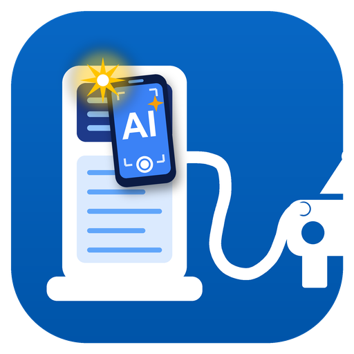
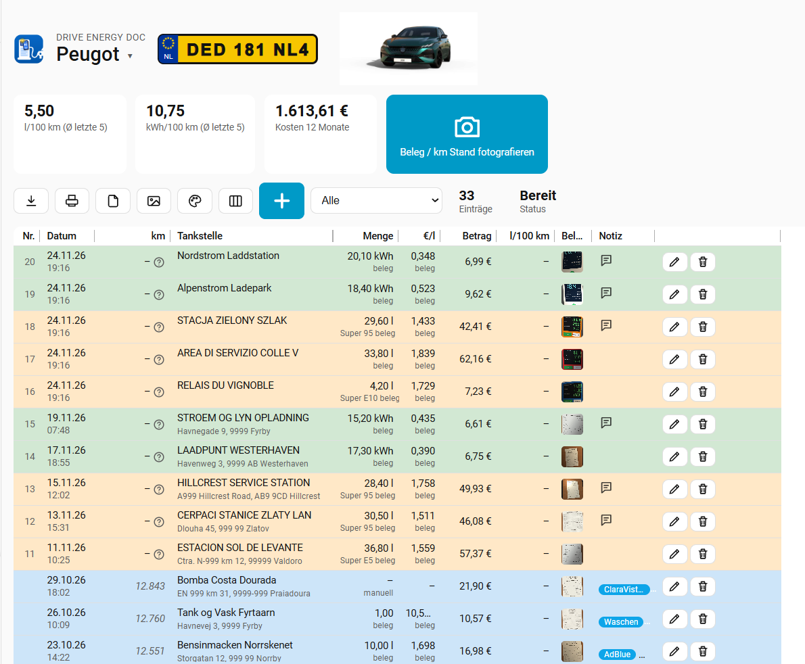
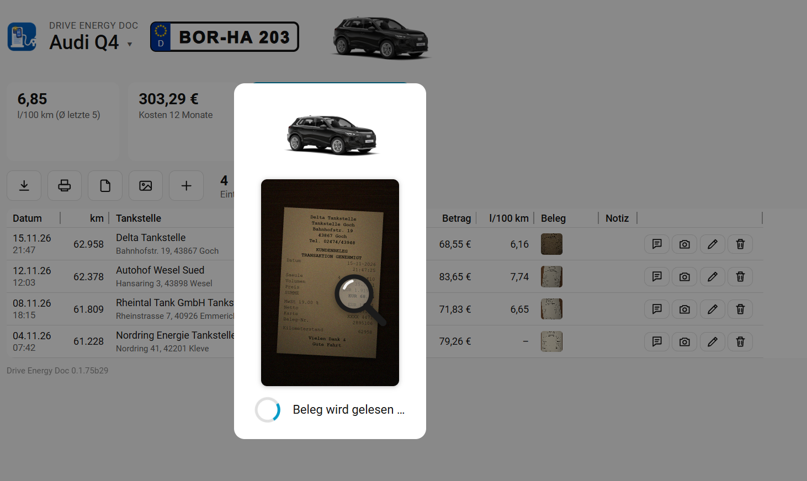
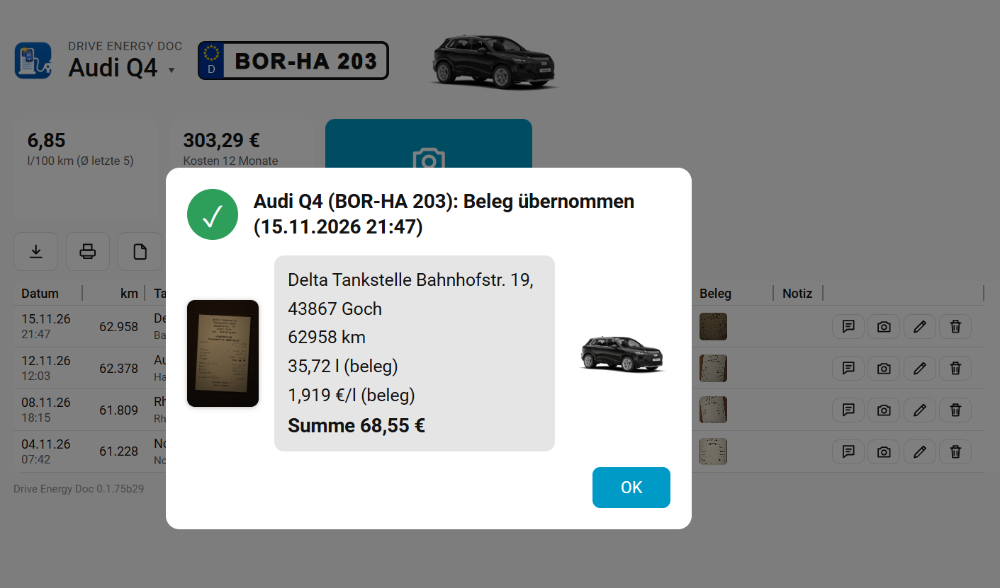
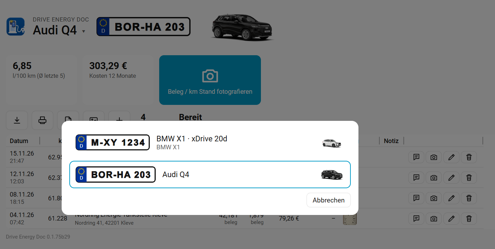
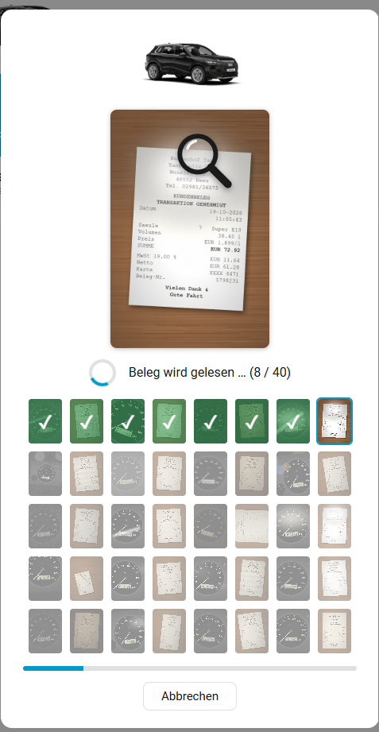
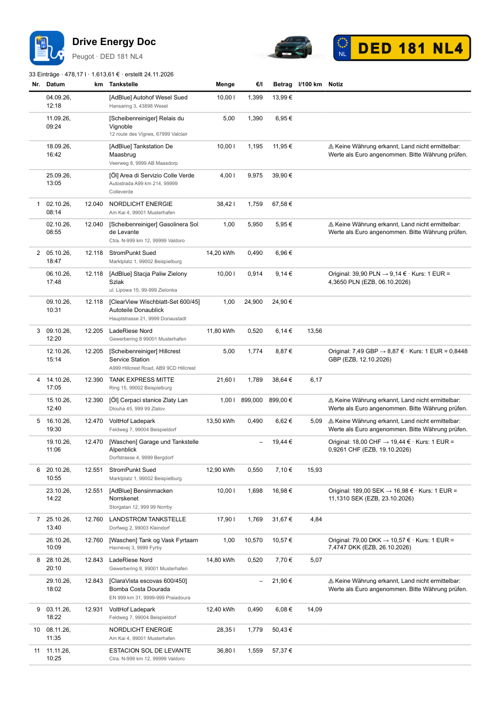
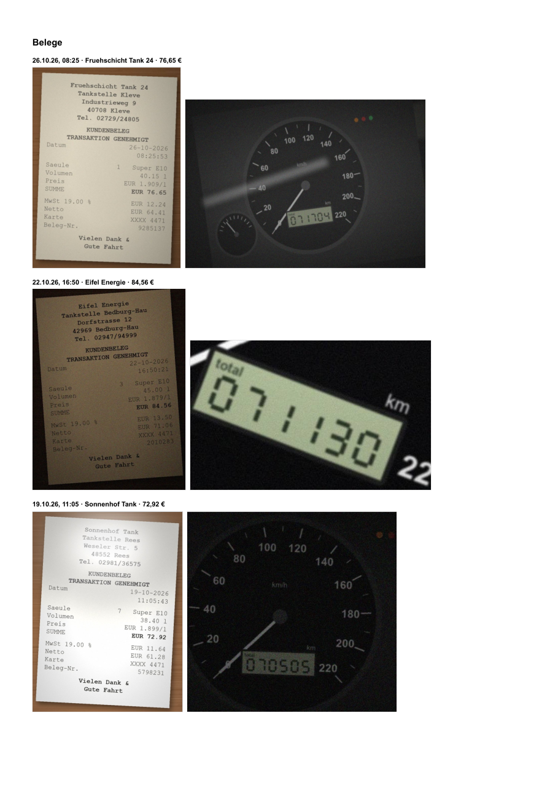

<p align="center"></p>

# Drive Energy Doc für Home Assistant

<p align="center">
<a href="https://github.com/AlphaLima/ha-drive-energy-doc/releases"></a>
<a href="LICENSE"></a>
<a href="https://github.com/AlphaLima/ha-drive-energy-doc/actions"></a>
</p>

[🇬🇧 English](README.md) · 🇩🇪 Deutsch

### Das smarte, vollautomatische Tankbuch

Ein **Tank- und Ladebuch für beliebig viele Fahrzeuge** (Verbrenner und Elektro), das sich vollautomatisch selbst führt.
Es gibt zwei Arten, es zu nutzen, die sich auch mischen lassen:

- **Mit Verbindung zum Auto (völlig automatisch):** Home Assistant erkennt das Tanken oder Laden selbst aus den Sensoren des Autos
  (Füllstand, Kilometerstand, GPS), legt den Eintrag an, holt den Preis und rechnet den Verbrauch aus. Der Fahrer muss nichts tun.
  Der Beleg ist hier nur eine Zugabe: Schickt man ihn per Telegram, liest ihn die KI, und die Abrechnung wird noch präziser
  (echte Menge, Preis und Summe) und der Vorgang zusätzlich dokumentiert.
- **Ganz ohne Verbindung zum Auto (Foto-Betrieb):** Es genügt, ein **Foto vom Tachostand** und ein **Foto von der Zapfsäule oder dem Beleg**
  per Telegram zu schicken. Die KI liest Kilometerstand, Menge, Preis und Summe, das Tankbuch wird geführt und die Belege werden archiviert.
  Dafür sind beim Fahrzeug keinerlei Sensoren nötig. Das ist **ideal für ein Flottenmanagement**: jedes Fahrzeug bekommt einen eigenen
  Telegram-Chat (z. B. mit dem Fahrer), und alle Fahrzeuge landen in einer Liste mit CSV- und PDF-Druck.

Auch **weiteres Verbrauchsmaterial** (AdBlue, Öl, Scheibenreiniger, …) lässt sich per Nachricht oder Foto dokumentieren; es zählt zu den Kosten, aber nicht zum Verbrauch.

Alles landet in einer Liste im Seitenmenü (mit CSV- und PDF-Druck).

## Inhalt
0. [Wozu das Ganze? Der Sinn des Tankbuches](#wozu-das-ganze-der-sinn-des-tankbuches) · [Die Wege ins Buch](#die-wege-daten-ins-buch-zu-bekommen)
0. [Foto-Betrieb ohne Auto-Anbindung](#foto-betrieb-ohne-auto-anbindung-flottenmanagement)
1. [So funktioniert es (Überblick)](#so-funktioniert-es-überblick)
2. [Wie ein Tanken erkannt wird (genau)](#wie-ein-tanken-erkannt-wird-genau)
3. [Welche Position und welcher Preis verwendet wird](#welche-position-und-welcher-preis-verwendet-wird) · [Länder mit Preisportalen](#länder-mit-preisportalen-unterstützt-und-nicht-unterstützt)
4. [Beleg, Zubehör und Tacho per Nachricht](#beleg-zubehör-und-tacho-per-nachricht)
5. [Wie der Verbrauch berechnet wird](#wie-der-verbrauch-berechnet-wird) · [Elektrofahrzeuge](#elektrofahrzeuge) · [Heimladen mit Heim-Wallbox](#heimladen-mit-heim-wallbox-optional-experimentell)
6. [Das Panel](#das-panel)
7. [Sensoren, Ereignis und Dienste](#sensoren-ereignis-und-dienste)
8. [Installation und Einrichtung](#installation-und-einrichtung) · [KI einrichten](#ki-für-die-belegerkennung-einrichten)
9. [Telegram einrichten](#telegram-einrichten) · [WhatsApp einrichten](#whatsapp-einrichten-offizielle-cloud-api-von-meta)
10. [Daten und Datenschutz](#daten-und-datenschutz)
11. [Grenzen](#grenzen) · [Tests](#tests) · [Lizenz](#lizenz)

---



*Das Panel (Beispieldaten): Fahrzeugkopf, Kennzahlen, großer Foto-Knopf und die Liste mit Belegfotos.*

> **Hinweis: Alle Screenshots, Beispiele und Testbilder in diesem Projekt zeigen frei erfundene Dummydaten.** Kennzeichen, Tankstellen, Adressen, Belege, Preise und Kilometerstände sind ausgedacht und gehören zu keinem echten Fahrzeug, keiner echten Person und keiner echten Tankstelle. Ähnlichkeiten mit echten Kennzeichen oder Orten sind Zufall.

<table>
<tr>
<td align="center"><br><sub>Die KI liest den Beleg (mit Lupe)</sub></td>
<td align="center"><br><sub>Ergebnis: Tankstelle, Menge, Preis, Summe</sub></td>
<td align="center"><br><sub>Fahrzeugauswahl per Klick auf den Kopfbereich</sub></td>
</tr>
</table>

**Mehrere Fotos auf einmal:** Über den Foto-Knopf lassen sich mehrere Bilder in einem Rutsch auswählen (Belege und Tacho-Fotos gemischt, in beliebiger Reihenfolge). Sie werden nacheinander verarbeitet, der Fortschrittsdialog zeigt alle Fotos mit Haken für die fertigen, Zähler und Balken; **Abbrechen** stoppt den ganzen Stapel. Rückfragen zu Kilometerstand und Verbrauch gibt es dabei nicht mitten drin: Tacho-Foto und Beleg werden über Aufnahmezeit (EXIF) und Kilometerstand einander zugeordnet, und am Ende zeigt eine Übersicht alle Ergebnisse samt Warnungen.

<p align="center"><br><sub>Stapelverarbeitung: 8 von 40 Fotos, fertige mit Haken, Fortschrittsbalken und Abbrechen</sub></p>

## Wozu das Ganze? Der Sinn des Tankbuches

Ein Fahrtenbuch/Tankbuch beantwortet Fragen, die man sonst nur schätzt:
- **Was kostet mein Auto wirklich?** Kraftstoff bzw. Strom, dazu Zubehör (AdBlue, Öl, Wischer) – je Monat und je 12 Monate.
- **Was verbraucht es wirklich?** Voll-zu-Voll gerechnet, unabhängig vom (oft zu optimistischen) Bordcomputer; Veränderungen
  (Winterreifen, Defekt, andere Fahrweise) werden sichtbar.
- **Belege und Nachweise:** Jede Zeile kann das Foto des Bons und des Tachostandes enthalten – für Steuer, Firmenwagen,
  Garantie oder Verkauf. Liste als CSV (Excel) oder PDF zum Ausdrucken.
- **Mehrere Fahrzeuge in einem Buch**, Verbrenner und Elektro gleich behandelt, ohne Zettelwirtschaft oder Tabellen von Hand.

Der Aufwand soll dabei so klein wie möglich sein: Das Auto meldet das Tanken von selbst, du schickst höchstens noch ein Foto vom Bon.

## Die Wege, Daten ins Buch zu bekommen

| Weg | Was du tust | Was automatisch passiert |
|---|---|---|
| **1. Automatisch (Sensoren)** | nichts | Füllstand steigt → Tanken erkannt, Menge, Ort, Kilometerstand und (wenn verfügbar) Preis werden eingetragen |
| **2. Beleg-Foto per Companion / Telegram / WhatsApp** | Bon oder Zapfsäule fotografieren und dem Bot schicken | KI liest Menge/Preis/Summe/Datum, Foto wird zugeschnitten und am Eintrag gespeichert, Werte vom Beleg ersetzen die geschätzten |
| **3. Beleg als Text** | `45,93 105,13` oder `27.10. 45,93 105,13` schreiben | Werte werden dem passenden Tanken zugeordnet (ohne KI) |
| **4. Zubehör** | `+ 24,90`, `extra Öl 1 9,50`, Kurzwort `adblue` oder Foto mit Bildtext | eigener Eintrag, zählt zu den Kosten, nicht zum Verbrauch |
| **5. Tacho-Foto / `km 54210`** | Tacho fotografieren oder Text senden | Kilometerstand wird dem zeitlich passenden Tanken zugeordnet; bei Zweifeln fragt der Bot nach |
| **6. Panel** | manuellen Eintrag („+“), Eintrag bearbeiten, Fotos hochladen oder löschen | – |
| **7. Dienst** `drive_energy_doc.submit_text` | z. B. aus einer Automation oder einem Skript Text einspeisen | wie Weg 3–5 |
| **8. Import (einmalig)** | Altdaten als `config/drive_energy_doc/import/<Fahrzeugname>/entries.json` (optional mit `photos/`, `originals/`) ablegen | Einträge samt Fotos werden beim nächsten Start übernommen |

Der **Beleg hat immer Vorrang** vor dem Automatischen: Das Auto schätzt, der Bon stimmt. Alle Wege führen in dasselbe Buch;
du kannst sie beliebig mischen (z. B. automatisch erkennen lassen und nur gelegentlich den Bon schicken).

## Foto-Betrieb ohne Auto-Anbindung (Flottenmanagement)

Beim Anlegen des Fahrzeugs sind nur Name, Energieart und Tankgröße Pflicht. Lässt du Füllstand-, Kilometerstand- und GPS-Sensor leer, arbeitet
das Fahrzeug rein über Nachrichten:

1. Der Fahrer schickt dem Bot ein **Foto vom Tacho** (oder `km 54210` als Text). Es wird ein neuer Eintrag mit diesem Kilometerstand angelegt.
2. Danach schickt er das **Foto vom Beleg oder der Zapfsäule** (bis 48 Stunden später). Die KI liest Menge, Preis, Summe und Datum, das Foto
   wird zugeschnitten und am Eintrag archiviert. Die Reihenfolge ist egal: kommt der Beleg zuerst, legt er den Eintrag an, der Tacho ergänzt ihn.
3. Zubehör (AdBlue, Öl …) geht genauso mit `+ 24,90` oder per Foto mit Bildtext.

Der Verbrauch (Voll-zu-Voll) wird aus den Kilometerständen und Mengen berechnet. Weil ohne Sensoren nicht bekannt ist, ob voll getankt wurde, gilt
jedes Tanken als voll. Für eine **Flotte** legst du je Fahrzeug einen eigenen Eintrag mit eigenem Telegram-Chat an; die Zuordnung läuft über die Chat-ID.

---

## So funktioniert es (Überblick)

```
Auto-Sensoren (Füllstand %, Kilometerstand, GPS)
        │
        ▼
 Erkennung: Füllstand steigt → Tanken läuft → Ruhe + Abstand → "fertig"
        │
        ├─► Preis nachschlagen (Tankstellen-Dienst, optional)
        ├─► Eintrag im Buch anlegen (Zeit, Menge, Preis, Kosten, Kilometerstand, Ort)
        └─► Nachricht per Companion-App/Telegram/WhatsApp: "Tanken erkannt – Beleg bei Bedarf nachreichen"
                   │
                   ▼
        Foto vom Bon / Zapfsäule / Text  ─►  KI liest Menge, Preis, Summe, Datum
                   │                         (Foto wird zugeschnitten und am Eintrag gespeichert)
                   ▼
        Der Beleg gewinnt immer: seine Werte ersetzen die geschätzten
```

Jedes Fahrzeug ist ein eigener Eintrag in der Integration. Daneben gibt es einen Eintrag **„Globale Einstellungen“**
für Dinge, die für alle Fahrzeuge gleich sind (Preisquellen, Strompreis, KI-Auswahl, Telegram/WhatsApp-Zugänge).
Jedes Fahrzeug hat seine eigene Konfiguration (Sensoren, Kraftstoffart, Schwellwerte, Chat), sein eigenes Buch und eigene Sensoren.

## Wie ein Tanken erkannt wird (genau)

Die Erkennung läuft als kleiner Automat, der bei jeder Änderung des **Füllstand-Sensors** (in %) arbeitet und alle 15 Sekunden
zusätzlich die Zeit prüft. Es sind vier Zustände:

1. **Ruhe.** Es passiert nichts, solange der Füllstand gleich bleibt oder sinkt (Fahren verbraucht Kraftstoff).
2. **Kandidat.** Sobald der Füllstand **steigt**, merkt sich die Integration den Wert davor (`Füllstand von`), den Zeitpunkt und die
   **Position**. Weitere Anstiege werden zu *einem* Vorgang aufaddiert (viele Autos melden die Füllung in mehreren kleinen Schritten).
3. **Gültig.** Sobald der Gesamtzuwachs **mindestens 5 %** erreicht (einstellbar), gilt der Vorgang als echtes Tanken. Kleinere
   Schwankungen (Lagesensor, Bergfahrt, Messrauschen) werden so ignoriert. Ab hier wird der Preis geholt (siehe unten).
4. **Fertig.** Das Tanken wird abgeschlossen, wenn **beides** zutrifft:
   - der Füllstand ist **60 Sekunden lang nicht weiter gestiegen** (einstellbar), und
   - das Auto ist **mehr als 250 m vom Tankort entfernt** (einstellbar, per Luftlinie zur Startposition).

   Warum der Abstand? Der Füllstand steigt oft verzögert; wer noch an der Zapfsäule steht, soll nicht schon einen Eintrag auslösen.
   Erst wenn das Auto losgefahren ist, steht fest, dass das Tanken beendet ist. Erst dann kommt die Nachricht, in der du bei Bedarf den Beleg nachreichen kannst (optional; der Eintrag ist auch ohne Beleg vollständig).

   **Ausnahme Elektroauto:** Hier entfällt die Entfernungsbedingung (das Auto bleibt beim Laden stehen). Standard ist **10 Minuten
   Ruhe** ohne weiteren Anstieg; auch das ist einstellbar. Die Abstandsregel lässt sich auch bei Verbrennern abschalten.

**Abbruch.** Wird der Zuwachs nach 10 Minuten nicht mehr größer und nie gültig (unter der Schwelle), wird der Kandidat verworfen.
Läuft Home Assistant gerade neu an, bleibt ein angefangener Vorgang erhalten (er wird gespeichert) und wird danach weitergeführt.

**Was im Eintrag landet:** Zeitpunkt, Füllstand von/bis, daraus die Menge (Zuwachs × Tankvolumen bzw. Akkukapazität),
Kilometerstand (aus dem Tacho-Sensor, falls vorhanden), Ort und der Preis (falls verfügbar). Ein Tankvolumen wird dafür einmal
beim Fahrzeug eingetragen.

## Welche Position und welcher Preis verwendet wird

**Position:** Es zählt die **zuletzt bekannte GPS-Position des Fahrzeugs (`device_tracker`) in dem Moment, in dem der erste
Füllstand-Anstieg eintrifft**. Das Auto steht dann an der Zapfsäule. Wichtig: Meldet das Auto den neuen Füllstand erst spät, kann die
zuletzt gemeldete Position noch vom Vorweg stammen. Dann zeigt der Eintrag den falschen Ort und der Preis kommt von der falschen
Tankstelle – der Beleg korrigiert den Preis in jedem Fall.

**Preis:** Optional. Beim Übergang zu „gültig“ sucht die Integration mit der Startposition die **nächste geöffnete Tankstelle im
Umkreis von 400 m** und nimmt den Preis der gewählten Kraftstoffart (Diesel, E5, E10). Quellen:

| Land | Dienst | Schlüssel |
|---|---|---|
| Deutschland | Tankerkönig | persönlicher, kostenloser API-Schlüssel |
| Österreich | E-Control | keiner nötig |
| Frankreich | prix-carburants (data.gouv.fr) | keiner nötig |
| Spanien | MINETUR / MITECO (Ministerium) | keiner nötig |
| Italien | MIMIT Osservaprezzi (Open Data) | keiner nötig |

Die Quelle richtet sich nach dem Land der Position (oder fest gewählt). Ohne jede Quelle funktioniert alles weiter; dann kommt der Preis
vom Beleg. **Elektro:** fester Preis je kWh oder ein Sensor/Helfer, der den Strompreis liefert (z. B. dynamischer Tarif).

### Länder mit Preisportalen: unterstützt und nicht unterstützt

Stand der Recherche: November 2026. Ein offizielles europaweites Portal mit Preisen **pro Tankstelle** gibt es nicht; die EU veröffentlicht nur
Durchschnittswerte. Jedes Land stellt seine Daten einzeln bereit, mit eigenem Format und eigenen Bedingungen.

**Unterstützt**

| Land | Quelle | Vorteile | Nachteile |
|---|---|---|---|
| Deutschland | Tankerkönig | Preis je Tankstelle, nahe Echtzeit, Marke und Adresse | persönlicher, kostenloser Schlüssel nötig; die Weitergabe von Echtzeitdaten an Dritte ist genehmigungspflichtig (für die private Nutzung im eigenen Home Assistant unkritisch) |
| Österreich | E-Control Spritpreisrechner | amtlich, kein Schlüssel, Preis je Tankstelle, geschlossene Tankstellen werden ausgelassen | nur Österreich; Aktualisierungsrhythmus nicht geprüft |
| Frankreich | prix-carburants (data.gouv.fr), „flux instantané“ | amtlich, kein Schlüssel, alle Tankstellen | liefert keinen Stationsnamen, nur die Adresse; Öffnungszeiten werden nicht geprüft |
| Spanien | MINETUR / MITECO (Ministerium) | amtlich, kein Schlüssel, laut Quelle stündlich aktualisiert, mit Markenname und Adresse | große Landesdatei (ca. 12 MB), erster Abruf rund 25 Sekunden (danach 30 Minuten im Zwischenspeicher); der Server verlangt eine ältere TLS-Einstellung (nur für diese Abfrage gesetzt); Öffnungszeiten werden nicht geprüft |
| Italien | MIMIT Osservaprezzi (Open Data, Lizenz IODL 2.0) | amtlich, kein Schlüssel, alle Tankstellen mit Koordinaten, Self-Service-Preis wird bevorzugt | Preise gelten als Stand 8 Uhr, nicht live; als „experimentell“ eingestuft, das Format kann sich ändern (das Trennzeichen wurde im Februar 2026 geändert); zwei Dateien (ca. 7 MB); Öffnungszeiten werden nicht geprüft |

**Nicht unterstützt**

| Land | Befund | Möglichkeit |
|---|---|---|
| Niederlande | Offiziell nur Durchschnittspreise vom Statistikamt CBS, keine Preise je Tankstelle. Drittanbieter nicht geprüft. | nur Beleg-Foto |
| Belgien | Keine offene Schnittstelle je Tankstelle gefunden. Es gibt amtliche Höchstpreise (nicht geprüft). | nur Beleg-Foto |
| Luxemburg | Das Wirtschaftsministerium setzt einen **landesweit einheitlichen Höchstpreis** je Kraftstoff. | ein Landespreis wäre möglich, noch nicht eingebaut |
| Portugal | Portal der DGEG (nur Festland). Keine dokumentierte offizielle Schnittstelle; ein Endpunkt ist nur aus Drittprojekten bekannt und kann sich ändern. | unsicher, nicht eingebaut |
| Dänemark, Zypern, Slowenien, Rumänien | Nach Angaben von Dritten offen oder neu verpflichtend, nicht bestätigt. | noch zu prüfen |
| Tschechien, Finnland, Griechenland, Polen, Ungarn, Schweiz | Nichts Brauchbares gefunden. | noch zu prüfen |

**Ohne Preisquelle** funktioniert alles weiter: Das Beleg-Foto liefert Tankstelle, Anschrift, Menge, Preis und Summe in jedem Land. Die Preisquelle
betrifft nur Fahrzeuge, die den Tankvorgang selbst erkennen (Füllstand und GPS). Weitere Länder sind als Beitrag willkommen: Ein Anbieter ist eine
Funktion in `price.py` plus Eintrag in `PROVIDERS` und `BY_COUNTRY`.

**Der Beleg hat immer Vorrang.** Menge, Preis und Summe vom Beleg überschreiben die geschätzten Werte. Ein Eintrag ist erst dann
als „Beleg geprüft“ markiert, wenn mindestens Menge, Preis oder Summe vom Beleg kamen.

## Beleg, Zubehör und Tacho per Nachricht

Die Nachrichten laufen über die **Companion-App mit dem Panel** (**der einfachste Weg und unsere Empfehlung zum Einstieg**: kein Konto, Token oder
Chat-ID nötig; das Foto machst du mit der Kamera im Panel, die Push-Nachricht kommt aufs Handy; nichts verlässt dein Heimnetz), über **Telegram**
(eigener Bot; zum Senden direkt aus dem Messenger und zum Beantworten von Rückfragen im Chat) oder über **WhatsApp** (Cloud-API von Meta). Pro Fahrzeug wählst du, welche Kanäle genutzt werden. Mit `?`, `h`, `help` oder `hilfe`
(auch `/help`, `/start`, oder das Wort für „Hilfe“ in der eigenen Sprache) zeigt der Bot alle Kommandos.

### Beleg zum Tanken
- **Foto** vom Bon oder von der Zapfsäule schicken. Die KI liest Menge, Preis, Summe, Datum und – falls sichtbar – den Kilometerstand.
  Das Foto wird **auf den Beleg zugeschnitten** (die KI nennt den Rahmen; ohne KI-Antwort greift eine einfache Erkennung hochformatiger,
  heller Papierbons). Das Original bleibt gesichert und ist im Panel einsehbar.
- **Text:** `45,93 105,13` (Menge Betrag), `45,93 2,289 105,13` (Menge Preis Betrag) oder mit Datum davor `27.10. 45,93 105,13`.
- **Weiteres Foto** zum letzten Tanken: Foto mit dem Wort `zusatz` im Bildtext.
- Ist ein Wert unplausibel oder nicht lesbar, antwortet der Bot mit einem Hinweis statt etwas Falsches zu speichern.

### Zubehör (AdBlue, Öl, Scheibenwischer …)
Alles, was Geld kostet, aber kein Kraftstoff ist. Kennwort **`+`, `e`, `x`, `extra`, `z`, `zub`** oder `zubehör`, danach optional die
Bezeichnung und die Zahlen: `+ 24,90`, `extra Öl 1 9,50`, `z Scheibenwischer 24,90`. Erlaubt sind nur Betrag, Menge Betrag oder Menge
Preis Betrag, optional mit Datum. Kurzwörter ohne Kennwort: `adblue`, `öl`, `scheibenwischer`, `scheibenwasser`, `frostschutz`.
Dasselbe als Bildtext zu einem Foto hängt den Beleg an den Eintrag. Zubehör erscheint als eigene Zeile, zählt zu den Kosten,
aber **nicht** in den Verbrauch.

### Tacho-Kilometerstand
**Rangfolge der Quellen:** Der Kilometerstand eines Eintrags kommt aus der besten verfügbaren Quelle: **1. die Entität des Autos** (Kilometerstand-Sensor), **2. das Foto vom Tacho**, **3. erst dann der Stand auf der Quittung**. Auf der Quittung steht er oft von Hand eingetragen und kann falsch sein, deshalb überschreibt er nie einen besseren Stand. Ein Stand, den du selbst tippst oder im Panel änderst, gilt als bewusste Entscheidung und gewinnt immer. Der Sensorwert gilt nur für einen Eintrag, der zeitlich dazu passt: Wird ein Beleg erst später hochgeladen (Datum mehr als 3 Stunden weg), wird der aktuelle Sensorwert nicht übernommen.

**Im Zweifel wird der Kilometerstand weggelassen.** Ein von der KI aus einem **Foto** gelesener Stand wird nie geraten und nie erfragt: Passt er nicht zum Eintrag,
liegt er unter dem vorigen Stand oder ergibt er einen unplausiblen Verbrauch, bleibt er leer und das Tacho-Foto hängt als Zusatzfoto am Eintrag. Auf Belegen
zählt ein Kilometerstand nur, wenn eine Zeile ausdrücklich so beschriftet ist (Belegnummer, Säulen- und Kartennummer sind es nicht) und er zur Reihenfolge der
Einträge passt (nicht unter dem vorigen, nicht über dem nächsten, höchstens 5000 km Sprung, höchstens sechs Stellen). Nachgefragt wird nur bei einem **von Hand
getippten** Stand (`km 54210`), denn den hast du selbst eingegeben; die folgenden Absätze beschreiben diesen Fall.

Foto vom Tacho oder Text wie `km 54210` senden. Der Wert wird dem Tankvorgang zugeordnet, dessen Zeit der Sendezeit am nächsten liegt
(Fenster 24 Stunden). Bei großer Abweichung vom gespeicherten Stand (> 300 km), einem Wert kleiner als beim vorigen Tanken oder
einem zu alten Tankvorgang fragt der Bot nach und wartet auf deine Bestätigung (`ja`).
Zusätzlich prüft er den **Verbrauch**: Ergeben der neue Stand, die getankte Menge (plus Teilbetankungen dazwischen) und die Kilometer seit dem letzten vollen Tanken einen Verbrauch, der mehr als 40 % vom Durchschnitt der letzten fünf Voll-zu-Voll-Werte abweicht, warnt er (z. B. „würde bei 200 km seit dem letzten Tanken 24,5 l/100 km ergeben, Durchschnitt 7,0 l/100 km“) und fragt, ob der Stand trotzdem übernommen werden soll (`ja` oder `nein`). Dieselbe Warnung steht unter einem Beleg, dessen Kilometerstand unplausibel wirkt. Die Prüfung braucht mindestens zwei frühere Verbrauchswerte und gilt nur für volle Betankungen.

## Wie der Verbrauch berechnet wird

Methode **Voll-zu-Voll**: Ein Tanken zählt als „voll“, wenn der Zuwachs **mindestens 30 %** beträgt. Zwischen zwei vollen Tanken
werden alle getankten Mengen addiert und durch die gefahrenen Kilometer geteilt (Ergebnis je 100 km bzw. kWh/100 km).
Teilbetankungen zeigen daher keinen eigenen Verbrauch, fließen aber in die nächste volle Rechnung ein. Zubehör zählt nicht.

**Nummerierung:** Jeder Tankvorgang bekommt in der Liste eine laufende Nummer (der älteste ist Nr. 1, Zubehör hat keine). Die Nummer steht auch im CSV-Export und im Ausdruck.

**Doppelte Belege:** Gibt es zu einem Tag schon einen Eintrag mit Beleg, meldet der Bot das und fragt, ob er ihn mit dem neuen Beleg überschreiben soll (`ja` oder `nein`). Ist es derselbe Beleg (gleiche Menge und Summe), sagt er das ausdrücklich. Bei `nein` wird das neue Foto wieder gelöscht.
Ist über den Zuwachs nichts bekannt (z. B. von Hand angelegt), gilt das Tanken als voll. Ohne Kilometerstand gibt es keine Rechnung.

## Elektrofahrzeuge

Elektroautos funktionieren genauso wie Verbrenner; die Unterschiede im Überblick:

**Einrichtung:** Beim Fahrzeug die Energieart **Elektro** wählen und als Kapazität die **nutzbare Akkukapazität in kWh** eintragen (z. B. 58). Als Füllstand-Sensor dient der **Ladezustand (SoC) in %**, optional Kilometerstand und GPS wie beim Verbrenner. Ohne Sensoren funktioniert auch hier der [Foto-Betrieb](#foto-betrieb-ohne-auto-anbindung-flottenmanagement) (z. B. Foto der Ladesäule oder der App-Rechnung).

**Erkennung:** Steigt der Ladezustand um mindestens **5 %**, wird ein Ladevorgang erkannt. Er ist beendet, wenn der Ladezustand **10 Minuten lang nicht weiter gestiegen** ist (Standard, einstellbar unter *Konfigurieren → Tankerkennung (Feintuning)*). Die **Entfernungsbedingung entfällt** (das Auto steht ja beim Laden), lässt sich aber einschalten. Bei bekannter Position, bekanntem Kilometerstand oder mit Stecker-Sensor beendet diese Zeit die Ladung gar nicht, siehe [Heimladen](#heimladen-mit-heim-wallbox-optional-experimentell). Viele kleine Ladungen am Tag werden einzeln als Vorgänge erfasst, sobald sie die 5 % erreichen.

**Menge:** kWh = Zuwachs in % × Akkukapazität. Das ist die Energie **im Akku**; an der Steckdose oder Wallbox wird wegen der Ladeverluste meist etwas mehr verbraucht. Willst du es genau, schick den Wert vom Beleg oder der Ladesäule (z. B. `38,2 0,39 14,90`); der Beleg hat immer Vorrang.

**Preis:** Es gibt keine Tankstellensuche. Stattdessen nimmt die Integration den **Strompreis je kWh** aus den *Globalen Einstellungen*: eine feste Zahl (z. B. `0,32`) oder eine Entität, die den aktuellen Preis liefert (z. B. dynamischer Tarif, Helfer oder Sensor). So bekommt jedes Laden **zu Hause** automatisch Preis und Kosten. Beim **öffentlichen Laden** schickst du die App-Rechnung oder ein Foto der Ladesäule per Telegram; die KI liest kWh, Preis und Summe, und der Beleg ersetzt den eingestellten Preis.

**Verbrauch:** Gerechnet wird wie beim Verbrenner nach Voll-zu-Voll, Ergebnis in **kWh/100 km**. Als „voll“ gilt ein Ladevorgang ab **30 %** Zuwachs; kleinere Ladungen werden bis zur nächsten größeren aufaddiert. Dafür braucht es Kilometerstände (Sensor, Tacho-Foto oder `km 54210`).

**Bekannte Grenzen:** Ohne Heim-Wallbox (siehe [Heimladen](#heimladen-mit-heim-wallbox-optional-experimentell)) ist die Menge akkuseitig. Meldet das Auto den Ladezustand nur alle paar Minuten, startet und endet ein Vorgang entsprechend verzögert. Zeigt der Ladezustand nur ganze Prozent, sind sehr kleine Ladungen ungenau.

### Schätzung, Beleg und Ladeverluste; AC und DC

Die Schätzung (Zuwachs in % × Kapazität) bleibt am Eintrag, auch wenn ein Beleg die Menge ersetzt. Aus beiden Werten lernt die Integration je Fahrzeug und Energieart einen **Korrekturfaktor** (Beleg ÷ Schätzung; er enthält Ladeverluste und einen eventuellen Fehler der angegebenen Kapazität). Ab **drei Einträgen mit Beleg** werden Ladungen **ohne** Beleg mit dem Median des Faktors korrigiert und als *berechnet (korrigiert)* gekennzeichnet; der Faktor steht in der Leiste über der Liste. Der Bearbeiten-Dialog zeigt die Schätzung und die Abweichung.

**AC oder DC** ist nur eine Vermutung und wird mit ihrer Quelle gespeichert: Vorrang hat ein optionaler *Ladeart-Sensor* der Fahrzeug-Integration, dann die Angabe AC/DC auf Beleg oder Säulenanzeige, dann die *Spitzenleistung* eines optionalen *Ladeleistungs-Sensors* gegen die größte AC-Leistung des Autos (Standard 11 kW, einstellbar) und zuletzt die *mittlere Leistung* der Sitzung. Die mittlere Leistung kann nur DC beweisen (z. B. 80 kW); langsames DC sieht aus wie AC, darum bleibt eine Ladung auch *unbekannt*. Die Faktoren werden je Ladeart gelernt, sobald es drei Einträge dieser Art gibt, sonst gemeinsam. Die Ladeart lässt sich im Bearbeiten-Dialog von Hand ändern. Die drei optionalen Felder stehen in der Gruppe *Sensoren* des Fahrzeugs.

### Plug-in-Hybrid

Beim Fahrzeug **Plug-in-Hybrid** ankreuzen (neben der Kraftstoffart, z. B. Benzin E10). Das Buch führt dann **beide Energiearten in einer Liste**: Jeder Eintrag ist entweder **Kraftstoff (l)** oder **Strom (kWh)**.
- **Per Beleg oder Foto:** Die KI erkennt einen Ladebeleg und legt einen Stromeintrag an, ein Tankbeleg ergibt einen Kraftstoffeintrag. Am selben Tag können beide nebeneinander stehen, ohne sich zu überschreiben.
- **Von Hand:** Im Bearbeiten-Dialog bietet das Feld **Art** *Kraftstoff* und *Strom* (sowie das Zubehör).
- **Der Verbrauch** wird **getrennt** je Energieart berechnet (l/100 km und kWh/100 km, jeweils gegen den vorigen Eintrag derselben Art). Das Panel zeigt beide Durchschnitte, es kommt ein zweiter Sensor „Stromverbrauch“ dazu, die Kosten beider werden summiert. Die Kilometer sind gemeinsam.
- **Automatische Erkennung für beides:** Neben dem Füllstand-Sensor des Tanks kannst du den **Akku-Ladestand (%)** und die **Akkugröße (kWh)** eintragen. Tanken und Laden werden dann unabhängig voneinander erkannt (zwei Sensoren, zwei Erkennungen); beim Laden gilt der Strompreis aus den globalen Einstellungen. **Rekuperation wird ignoriert:** Beim Fahren steigt der Akku-Stand ohne Laden. Bewegt sich das Fahrzeug mehr als 200 m vom Beginn des Anstiegs weg (GPS) oder um mindestens 1 km (Kilometerstand), zählt der Anstieg nicht als Laden; ein Kandidat wird verworfen, und nach einem echten Laden werden Anstiege beim Wegfahren nicht mehr mitgezählt. Ohne Akku-Sensor wird das Laden per Beleg, Foto, Nachricht oder von Hand erfasst.
- Bei gemischter Fahrweise sind die beiden Einzelwerte ungenauer als bei reinem Verbrenner oder Elektroauto: Der Kraftstoffverbrauch eines Plug-in-Hybrids hängt davon ab, wie viel elektrisch gefahren wurde. Die Werte sind als Trend gedacht, die Kostensumme ist exakt.
- **Plausibilitätsprüfung beim Hybrid:** Weil im Wechsel Benzin und Strom verbraucht werden (Benzin ist oft die Ausnahme), meldet die Liste **keinen** einzelnen niedrigen oder hohen Verbrauch je Energieart, und die Kilometerprüfung bei Fotos entfällt. Stattdessen wird der **gemeinsame** Verbrauch beider (Liter in kWh umgerechnet) ab 300 km Strecke geprüft, und nur ein **zu hoher** Wert (über etwa 60 kWh/100 km) bekommt ein Warndreieck; ein niedriger Wert ist normal, weil nicht jede Ladung (z. B. zu Hause) erfasst wird.

### Heimladen mit Heim-Wallbox (optional, experimentell)

Für Autos, die zu Hause laden, lässt sich eine Wallbox ergänzen. Was man wirklich bezahlt, ist die Energie, die durch den Wallbox-Zähler lief, nicht die Schätzung aus dem Ladezustand. Die Funktion ist **optional und experimentell** und steht getrennt von den Sensoren des Autos in einem Untermenü ganz unten in den Fahrzeug-Optionen: *Konfigurieren → Heim-Wallbox (optional, experimentell)*. Es gibt sie nur für Elektroautos und Plug-in-Hybride (mit Akku-Sensor).

**Felder (alle optional)**

| Feld | Bedeutung |
|---|---|
| Zählerstand der Wallbox (kWh) | Gesamtzähler der Wallbox, wächst nur beim Laden (Wh-Zähler werden umgerechnet). Ohne ihn gilt nichts von dem Folgenden. |
| Ladeleistung der Wallbox | Aktuelle Leistung. Macht den Beginn genauer (letzter Ruhestand vor der Ladung) und zeigt die kW in der Live-Zeile. |
| Preis €/kWh der Ladung | Eine Entität (Sensor, Eingabezahl), z. B. ein Mischpreis aus Netz und Solarstrom. Leer = Strompreis aus den globalen Einstellungen. |
| Solaranteil der Ladung in % | Ein Sensor mit dem aktuellen Solaranteil. |
| Stecker: Auto angesteckt | Binär- oder Textsensor (`on`/`off`, `connected`/`disconnected`, `charging`, `available` …). Damit endet eine Ladung beim Abstecken. |

**Menge und Verluste.** Ist eine Ladung abgeschlossen, bildet DED die Differenz des Wallbox-Zählers zwischen Beginn und Ende. Dieser Wert ersetzt die Schätzung (Quelle *wallbox*) und enthält die Ladeverluste. Weil Schätzung und Wallbox-Wert beide bekannt sind, fließen die Verluste wie bei einem Beleg in den gelernten Korrekturfaktor ein (siehe oben), auch für Ladungen unterwegs.
Der Wallbox-Wert wird nur übernommen, wenn er plausibel ist: Er muss das 0,85- bis 1,7-Fache der Schätzung betragen. Sonst hat das Auto woanders geladen oder zwei Ladungen liefen über denselben Zähler, und die Schätzung bleibt. Nutzen zwei Fahrzeuge dieselbe Wallbox-Entität und überlappen sich die Ladezeiten, wird ebenfalls nichts geraten. Der Eintrag trägt dann einen kurzen Hinweis, warum (*geteilt*, *kein Verlauf*, *passt nicht*).

**Preis und Solaranteil.** Während der Ladung werden Preis- und Solarsensor etwa alle 15 Sekunden gelesen und gemittelt (zeitgewichtet, *unknown* wird übersprungen). Der Eintrag bekommt diesen mittleren Preis (Quelle *Wallbox*) und, wenn ein Solarsensor gesetzt ist, den Solaranteil als „☀ 62 %“ in der Liste. Ohne Preissensor gilt der globale Strompreis.

*Beispiel, Mischpreis und Solaranteil als Template-Sensoren in Home Assistant:* Mit der Wallbox-Leistung `W` und dem Netzbezug `grid` (beide in W) wird `netz = min(W, max(grid, 0))` aus dem Netz gedeckt und `solar = W − netz` aus PV und Batterie. Solaranteil in % = `solar / W · 100`; Mischpreis = `(netz · Bezugspreis + solar · Einspeisevergütung) / W` (der Solarteil wird mit der Vergütung bewertet, die er sonst einbrächte). Unter 50 W sollten die Sensoren *unknown* melden. Die Hauslast wird nicht von der PV-Leistung abgezogen, der Solaranteil ist also eher vorsichtig.

**Lange Pausen (Überschussladen).** Bei Elektroautos wird eine Ladung **nicht mehr durch die Abschlusszeit** (10 Minuten) beendet. Ist die Position oder der Kilometerstand des Autos bekannt oder ein Stecker-Sensor gesetzt, bleibt die Ladung über Pausen von Stunden (Wolken) offen und läuft als derselbe Eintrag weiter. Sie endet

- wenn das Auto **wegfährt** (mehr als 200 m vom Beginn oder 1 km am Kilometerstand; spätere Anstiege des Ladezustands durch Rekuperation werden ignoriert), oder
- wenn es **abgesteckt** wird (Stecker-Sensor; dann wird noch die Abschlusszeit abgewartet, weil das Auto den Ladezustand verzögert meldet), oder
- spätestens nach **48 Stunden ohne Anstieg**.

Ohne Position, Kilometerstand und Stecker-Sensor gilt wie bisher die Abschlusszeit. Der Wallbox-Zähler bei Beginn und bei der letzten Lieferung wird während der Ladung mitgeschrieben, die Menge stimmt also auch nach langen Pausen oder einem Neustart von Home Assistant.

**Live-Zeile.** Solange ein Auto lädt, steht eine türkise Zeile **„Lädt gerade“** oben in der Liste: Beginn, Ladezustand von → bis, Menge (Wallbox-kWh, sonst Schätzung) und Leistung. Sie wird jede Minute aktualisiert und zeigt *pausiert*, wenn nichts geliefert wird. Sie verschwindet, sobald der Eintrag abgeschlossen ist.

**Filter und Farbe „Heimladen“.** Einträge, deren Menge von der Heim-Wallbox stammt, sind **gelb hinterlegt** und über den Filter **„Heimladen (n)“** auswählbar (auch für Druck und Export der gefilterten Liste).

**Wallbox abschalten.** Das Ende einer Ladung hängt nicht von der Wallbox ab. Wird sie abgeschaltet oder stromlos, behält ihr Zähler den letzten Wert, und ein nicht verfügbarer Leistungssensor zählt als 0 W. Setzt eine Wallbox ihren Zähler beim Stromausfall auf null zurück, lässt sich die Menge dieser Ladung nicht berechnen, und die Schätzung bleibt (ein Gesamtzähler tut das nicht).

**Grenzen.** Der Verlauf der Wallbox liegt nur im Speicher (Beginn und letzte Lieferung einer laufenden Ladung werden gespeichert). Die Mittelwerte sind zeitgewichtet, nicht nach Leistung gewichtet. Die Texte des Optionsformulars gibt es auf Deutsch und Englisch.

## Das Panel

Nach der Einrichtung erscheint das Panel in der Seitenleiste, benannt nach der Systemsprache von Home Assistant (Deutsch **„Tankbuch“**, Englisch „Fuel log“, Französisch „Carnet de carburant“ …):
- Liste aller Tanken/Ladungen und Zubehör je Fahrzeug, Spalten verschiebbar und in der Breite änderbar. Der Spalten-Knopf über der Liste blendet nicht benötigte Spalten aus; die Auswahl wird pro Browser gemerkt, ein Doppelklick auf einen Spaltentrenner setzt alles zurück.
- Kennzeichen-Darstellung (alle europäischen Länder, EU-Ring bzw. gelb für NL/GB), Fahrzeugbild und -typ in der Kopfzeile. Bei mehreren Fahrzeugen öffnet ein Klick auf den Kopfbereich (Logo, Fahrzeugtyp, Kennzeichen) einen Auswahldialog mit allen Fahrzeugen. Kennzeichen und Land stellst du in der Konfiguration des Fahrzeugs ein.
- Belegfotos und Tacho-Fotos mit Vorschau beim Überfahren, Löschen mit Rückfrage; Foto-Upload, auch **mehrere Fotos auf einmal** (Fortschrittsdialog mit Abbrechen, Verarbeitung nach Aufnahmezeit, Übersicht mit Warnungen am Ende). Rückfragen im Dialog haben fertige Antwort-Knöpfe (z. B. „Übernehmen“, „Neuer Eintrag“, „Abbrechen“).
- Bearbeiten und manueller Eintrag („+“) in **einem Dialog mit allen Feldern** (Art: Kraftstoff bzw. Strom oder Zubehör / Verbrauchsmaterial, auch nachträglich umstellbar; Datum und Uhrzeit, Menge, Preis, Betrag, Kilometerstand, Notiz), Ort mit kleiner Google-Maps-Verknüpfung.
- **Fremdwährung:** Belege in CHF, PLN, CZK, GBP, SEK, DKK u. a. werden zum EZB-Tageskurs des Belegdatums in Euro umgerechnet. Die Notiz enthält Originalbetrag, Euro-Betrag und den verwendeten Kurs. Ist kein Kurs abrufbar, bleiben die Werte unverändert und die Notiz warnt.
- **Kategorie aus dem Beleg:** Die KI erkennt AdBlue, Öl, Scheibenreiniger, Autowäsche und sonstiges Zubehör und legt einen eigenen Zubehör-Eintrag an (nie wird ein Tankvorgang überschrieben). Ist ein Foto nicht lesbar, öffnet sich der Dialog „Eintrag von Hand“ mit dem Foto. Ist die KI überlastet (Google 503), gibt es einen Warnhinweis statt einer falschen Meldung.
- **Fotos:** sprechende Dateinamen (`2026-10-15_1240_Oel_Haendler.jpg`), komprimiert gespeichert; Zubehör-Zeilen sind farbig hinterlegt, die Liste hat einen Zeilen-Cursor und ist standardmäßig nach Nummer absteigend sortiert. Testbelege (auch verknittert, ausgeblichen, schlecht beleuchtet) liegen in `tests/test_images_zubehoer/`.
- **CSV-Export** (Excel-tauglich) und **Druck/PDF** (Hoch- oder Querformat, mit oder ohne Belege).

### Beispiel-Ausdruck

Der Druck (Knopf „Drucken“ im Panel) erzeugt eine Liste aller Einträge und, wenn gewünscht, danach die Belege mit den Foto-Paaren. Das Beispiel stammt aus den [Testbildern](tests/test_images/README.md) (alles Dummydaten): 18 Einträge, nummeriert und nach Datum sortiert (der älteste ist Nr. 1), mit Summenzeile (Einträge, Liter, Kosten, Erstelldatum). Einzelne Verbrauchswerte weichen ab, etwa bei dem Ölbon (Nr. 7) oder wo ein Zwischenstopp fehlt; das sind Eigenheiten der Testdaten.

<table>
<tr>
<td align="center"><br><sub>Seite 1: die Liste</sub></td>
<td align="center"><br><sub>Seite 3: Beleg- und Tacho-Fotos je Eintrag</sub></td>
</tr>
</table>

Das ganze Beispiel (15 Seiten) als PDF: [docs/beispiel-ausdruck.pdf](docs/beispiel-ausdruck.pdf).

## Sensoren, Ereignis und Dienste

Je Fahrzeug: **Status**, **letztes Tanken**, **letzter Preis**, **Verbrauch** (Ø der letzten 5, Voll-zu-Voll), **Kosten 12 Monate**.
Bei jedem erkannten Tanken wird das Ereignis `drive_energy_doc_refuel` ausgelöst (für eigene Automationen).
Dienste: `drive_energy_doc.export_csv` (schreibt `config/drive_energy_doc/<Name>.csv`), `drive_energy_doc.submit_text` (Text wie eine
Nachricht einspeisen) und `drive_energy_doc.test_message`.

## Installation und Einrichtung

**Marketplace / HACS:** Im Marketplace von Home Assistant (ab 2026.11; vorher in HACS) nach *Drive Energy Doc* suchen, installieren, HA neu starten. *Ausweichweg, solange die Integration noch nicht im Standardkatalog steht (oder die Suche sie nicht findet):* das Repository `AlphaLima/ha-drive-energy-doc` als benutzerdefiniertes Repository hinzufügen (Typ *Integration*; dafür wird ein GitHub-Konto verbunden). Updates erscheinen dort, sobald ein neues Release veröffentlicht ist; Beta-Versionen sieht nur, wer Vorabversionen anzeigen lässt. **Manuell:** den Ordner `custom_components/drive_energy_doc` nach `config/custom_components/` kopieren,
HA neu starten.

Dann *Einstellungen → Geräte & Dienste → Integration hinzufügen → Drive Energy Doc*:

1. **Globale Einstellungen** anlegen: Preisquelle (automatisch nach Land oder fest), Tankerkönig-Schlüssel (nur für Deutschland),
   Strompreis, KI (leer = Gemini automatisch, sonst eine `ai_task`-Entität; Einrichtung der KI: [KI für die Belegerkennung einrichten](#ki-für-die-belegerkennung-einrichten)), Nachrichtenkanäle (Companion, Telegram, WhatsApp; WhatsApp-Zugangsdaten stehen ebenfalls hier, der Telegram-Token wird dagegen beim Fahrzeug eingetragen).
2. **Fahrzeug hinzufügen:** Pflicht sind nur Name, Energieart (Diesel/E5/E10/Elektro) und Tankvolumen bzw. Akkukapazität.
   **Optional:** Füllstand-Sensor (in %), Kilometerstand-Sensor, `device_tracker`. Ohne diese Sensoren gibt es keine automatische
   Erkennung; Einträge entstehen dann nur per Foto/Text oder im Panel, und jeder Beleg ohne passenden Eintrag legt automatisch
   einen neuen an (reiner Foto-Betrieb). Ebenfalls optional: Kennzeichen und Land (vor dem Speichern siehst du das gezeichnete Schild **und das Fahrzeugbild** als Vorschau), Fahrzeugtyp, Sprache der Bot-Antworten, Fahrzeugbild, Telegram-Chat.
3. Schwellwerte (5 %, 60 s, 250 m) und Nachrichtenkanäle sind je Fahrzeug unter *Konfigurieren* änderbar.

Voraussetzungen: Home Assistant ab 2025.8; für das Lesen von Belegen eine `ai_task`-Integration (Gemini, OpenAI, Anthropic …).

## KI für die Belegerkennung einrichten

Belege und Tacho-Fotos liest eine KI. Drive Energy Doc nutzt dafür die **AI-Task-Funktion von Home Assistant**, nutzt also eine KI-Integration, die du dort schon eingerichtet hast. Eine eigene KI-Verbindung gibt es in diesem Projekt nicht. Ohne KI funktioniert alles andere weiter: Du tippst dann Menge und Betrag (`45,93 105,13`) oder einen Kilometerstand (`km 54210`).

**Schritt für Schritt (Beispiel Google Gemini):**

1. **KI-Integration hinzufügen:** *Einstellungen → Geräte & Dienste → Integration hinzufügen → Google Gemini* (in älteren Anleitungen „Google Generative AI“). Die offizielle Anleitung von Home Assistant: [Google Gemini](https://www.home-assistant.io/integrations/google_generative_ai_conversation).
2. **API-Schlüssel erzeugen:** bei [Google AI Studio](https://aistudio.google.com/app/apikey) (laut Home-Assistant-Anleitung kostenlos, solange am Google-Cloud-Projekt keine Abrechnung hängt) und bei der Einrichtung eintragen.
3. **AI-Task-Entität prüfen:** Die KI-Integration stellt für Aufgaben wie das Lesen von Belegen eine *AI-Task*-Entität bereit (Hintergrund: [AI Task](https://www.home-assistant.io/integrations/ai_task/)). Du siehst sie unter *Einstellungen → Geräte & Dienste → Entitäten* (Suche nach `ai_task`) und kannst unter *Einstellungen → System → KI* eine bevorzugte wählen.
4. **In Drive Energy Doc:** In den **globalen Einstellungen** das Feld „KI“ **leer lassen**: Dann nimmt die Integration automatisch die Gemini-Entität, sonst die erste vorhandene `ai_task`-Entität. Oder du wählst dort gezielt eine andere.
5. **Testen:** Im Panel ein Foto eines Belegs hochladen. Nach wenigen Sekunden steht der Eintrag in der Liste.

**Claude (Anthropic) statt Gemini:** funktioniert genauso. Die Integration *Anthropic* hinzufügen und deren AI-Task-Entität in den globalen Einstellungen bei „KI“ **ausdrücklich auswählen**. Bleibt das Feld leer und sind Gemini und Claude installiert, wird Gemini bevorzugt. Wird die gewählte Entität später gelöscht (z. B. nach einem Anbieterwechsel), weicht die Integration auf eine andere AI-Task-Entität aus und schreibt eine Warnung ins Log. Ist der Anbieter überlastet (Gemini 503, Claude 529), versucht sie es bis zu viermal und sagt dann, dass du es später noch einmal versuchen sollst.

**Andere Anbieter:** Es geht mit jeder KI-Integration, die AI-Task-Entitäten bereitstellt und **Bilder** versteht, zum Beispiel [OpenAI](https://www.home-assistant.io/integrations/openai_conversation/) ([Schlüssel](https://platform.openai.com/account/api-keys), laut Home Assistant kostenpflichtig) oder [Anthropic](https://www.home-assistant.io/integrations/anthropic/) ([Schlüssel](https://console.anthropic.com/settings/keys), ebenfalls kostenpflichtig). Die Genauigkeit beim Lesen schlecht fotografierter Tachos hängt vom Modell ab.

**Gut zu wissen:**
- **Datenschutz:** Das Foto geht zur Auswertung **an den KI-Anbieter**, also aus deinem Haus heraus. Laut Home Assistant werden bei Google im kostenlosen Tarif Anfragen und Antworten zur Produktverbesserung verwendet; mit Abrechnung am Projekt gilt das nicht. Prüfe die Bedingungen deines Anbieters, bevor du Belege mit persönlichen Daten schickst.
- **Überlastung:** Kostenlose Dienste melden manchmal „zu hohe Nachfrage“ (Fehler 503). Die Integration versucht es dann einmal nach 3 Sekunden erneut. Kommt wieder nichts, bleibt das Foto gespeichert und du tippst Menge und Betrag bzw. den Kilometerstand.
- **Anfragen:** Pro Foto geht eine Anfrage an die KI, bei einem schnellen Fehlschlag höchstens eine Wiederholung.

## Telegram einrichten
Telegram ist der einfachste Kanal: kostenlos, ohne Firmenkonto und ohne öffentlich erreichbares Home Assistant (die Integration fragt Telegram selbst ab).

**Du brauchst:** ein Telegram-Konto und etwa fünf Minuten.

1. **Bot anlegen.** In Telegram den Kontakt **@BotFather** öffnen, `/newbot` senden, einen Anzeigenamen und einen Benutzernamen (muss auf `bot` enden) wählen. BotFather antwortet mit dem **Token** (sieht aus wie `123456789:ABC…`). Der Token ist wie ein Passwort: nicht weitergeben, nicht in Screenshots zeigen.
2. **Kanal freischalten (einmalig).** *Einstellungen → Geräte & Dienste → Drive Energy Doc → „Drive Energy Doc Einstellungen“ → Konfigurieren → Kanäle, Preisquelle, KI* und bei den Kanälen **Telegram** ankreuzen.
3. **Chat-ID herausfinden.** Dem neuen Bot in Telegram eine Nachricht schreiben (z. B. `/start`). Dann im Browser `https://api.telegram.org/bot<TOKEN>/getUpdates` öffnen (statt `<TOKEN>` deinen Token einsetzen) und die Zahl hinter `"chat":{"id":` suchen. Das ist die Chat-ID (in Gruppen negativ). Ist der Bot schon bei einem anderen Fahrzeug eingetragen, antwortet er auf `/start` aus einem neuen Chat von selbst mit der Chat-ID.
4. **Beim Fahrzeug eintragen.** *Drive Energy Doc → Fahrzeug → Konfigurieren → Kommunikation → Telegram*: **Bot-Token** und **Chat-ID** eintragen. Mit dem Schalter **„Testnachricht senden“** prüfst du sofort, ob alles stimmt: die Nachricht kommt im Chat an und als Benachrichtigung in Home Assistant.
5. **Benutzen.** Dem Bot Beleg-Fotos, Tacho-Fotos oder Text schicken (siehe [Beleg, Zubehör und Tacho per Nachricht](#beleg-zubehör-und-tacho-per-nachricht)). Mit `?` listet er alle Kommandos.

**Mehrere Fahrzeuge oder Fahrer (Flotte):** Du kannst **einen** Bot für alle Fahrzeuge nutzen. Jedes Fahrzeug bekommt dann eine **eigene Chat-ID**: jeder Fahrer schreibt dem Bot in seinem eigenen Chat, oder du legst je Fahrzeug eine Gruppe an und fügst den Bot hinzu. **Mache den Bot in der Gruppe zum Administrator** (siehe unten). Die Zuordnung zum Fahrzeug läuft allein über die Chat-ID. Alternativ legst du je Fahrzeug einen eigenen Bot an.

**Wenn nichts ankommt:**
- Antwortet der Bot gar nicht: Token prüfen, und ob ein **zweites Programm** denselben Token abfragt (Node-RED, `telegram_bot` mit Polling, ein zweites Home Assistant). Ein Token darf nur von **einem** Programm abgefragt werden.
- Schreibt der Bot, dass die Chat-ID „keinem Fahrzeug zugeordnet“ ist: Zahl beim richtigen Fahrzeug eintragen.
- **In einer Gruppe passiert beim Senden eines Fotos nichts? Mache den Bot zum Administrator der Gruppe.** Telegram gibt einem Bot in Gruppen standardmäßig nur Befehle (z. B. `/help`) weiter, aber keine normalen Nachrichten und keine Fotos. Admins sehen alles. In Telegram: Gruppe öffnen → **⋮ (drei Punkte) → Gruppe verwalten → Administratoren → Administrator hinzufügen** → den Bot wählen → Speichern (besondere Rechte sind nicht nötig). Mit einem Foto oder `/help` testen. Taucht im Home-Assistant-Log eine Nachricht aus der Gruppe mit „keinem Fahrzeug zugeordnet“ auf, empfängt der Bot sie bereits, und nur die Chat-ID beim Fahrzeug fehlt.
- Alternative zum Admin-Status: bei @BotFather `/setprivacy` → Bot wählen → **Disable**, danach den Bot aus der Gruppe entfernen und neu hinzufügen.
- Fremde Chats werden nie verarbeitet; es werden nur Nachrichten der eingetragenen Chat-ID angenommen.

## WhatsApp einrichten (offizielle Cloud API von Meta)
WhatsApp ist aufwendiger als Telegram, aber praktisch, wenn die Fahrer WhatsApp ohnehin nutzen. Es wird die **offizielle WhatsApp Cloud API von Meta** verwendet.

**Du brauchst:**
- ein Meta-Entwicklerkonto (developers.facebook.com) und eine App vom Typ „Business“ mit dem Produkt „WhatsApp“,
- eine **Telefonnummer** für den Bot: zum Ausprobieren stellt Meta eine Testnummer bereit (Empfänger müssen dort vorher eingetragen werden), für den echten Betrieb eine eigene, bei WhatsApp registrierte Nummer,
- Home Assistant muss **aus dem Internet per HTTPS** erreichbar sein, und zwar ohne Anmeldung unter `/api/drive_energy_doc/whatsapp` (z. B. Nabu Casa, Tailscale Funnel, Cloudflare Tunnel oder ein Reverse Proxy). Meta ruft diese Adresse auf, sobald eine Nachricht eintrifft.

**Schritte:**
1. In der Meta-App unter *WhatsApp → API-Einrichtung* die **Telefonnummer-ID** notieren und einen **dauerhaften Zugriffstoken** erzeugen (über einen Systemnutzer im Business-Manager; der vorläufige Token läuft nach 24 Stunden ab). Das **App-Secret** steht unter *App-Einstellungen → Allgemein*.
2. In Home Assistant *Drive Energy Doc → „Drive Energy Doc Einstellungen“ → Konfigurieren → WhatsApp-Zugang*: Token, Telefonnummer-ID, ein **frei gewähltes Verify-Token** und das App-Secret eintragen. Ohne App-Secret verarbeitet die Integration eingehende Nachrichten nicht (die Herkunft kann dann nicht geprüft werden). Bei den Kanälen (*Kanäle, Preisquelle, KI*) **WhatsApp** ankreuzen.
3. In der Meta-App unter *WhatsApp → Konfiguration → Webhook* eintragen: Callback-URL `https://<deine-öffentliche-HA-Adresse>/api/drive_energy_doc/whatsapp`, dasselbe **Verify-Token**, und das Feld **`messages`** abonnieren.
4. Beim Fahrzeug (*Konfigurieren → Kommunikation → WhatsApp*) die **Nummer des Fahrers** eintragen, mit Landesvorwahl, ohne `+` und Leerzeichen (z. B. `4917012345678`). Nur Nachrichten dieser Nummer werden angenommen. Mit dem Schalter „Testnachricht senden“ prüfst du den Weg.
5. **Wichtig, 24-Stunden-Regel:** WhatsApp erlaubt Nachrichten von sich aus (z. B. „Tanken erkannt“) nur innerhalb von 24 Stunden nach der letzten Nachricht des Fahrers. Danach geht nur eine von Meta **freigegebene Vorlage** (Kategorie *Utility*) mit einem Text wie `Drive Energy Doc: {{1}}`. Den Vorlagennamen und den Sprachcode trägst du in den WhatsApp-Einstellungen ein. Ohne Vorlage kommt die Meldung nur im offenen Fenster an. Antworten auf Nachrichten des Fahrers sind immer möglich.

Hinweis: Preise und Regeln von Meta ändern sich; informiere dich bei Meta über Kosten für Vorlagen-Nachrichten und die Anforderungen an das Business-Konto.

## Sprachen
Panel und Bot sprechen **36 Sprachen**: Deutsch, Englisch, Französisch, Spanisch, Italienisch, Niederländisch, Portugiesisch, Polnisch, Tschechisch, Slowakisch, Slowenisch, Kroatisch, Serbisch, Bosnisch, Mazedonisch, Bulgarisch, Ukrainisch, Belarussisch, **Russisch**, Rumänisch, Ungarisch, Griechisch, Türkisch, Albanisch, Litauisch, Lettisch, Estnisch, Finnisch, Schwedisch, Dänisch, Norwegisch, Isländisch, Irisch, Maltesisch, Luxemburgisch und Katalanisch.
- **Panel:** folgt automatisch der Sprache des angemeldeten HA-Benutzers; ist sie nicht dabei, erscheint Englisch.
- **Bot-Antworten:** je Fahrzeug einstellbar (*Konfigurieren → Fahrzeug*, Feld „Sprache der Bot-Antworten“), Standard ist die Sprache von Home Assistant. So kann jedes Fahrzeug einer Flotte in der Sprache seines Fahrers antworten.
- **Kommandos:** `?`, `help`, `extra`, `+`, `ja`/`nein`/`neu` und die Kurzwörter für Verbrauchsmaterial werden in **allen** Sprachen verstanden, unabhängig von der Antwortsprache.
- Die Einrichtungsdialoge in Home Assistant gibt es auf Deutsch und Englisch (andere Sprachen fallen auf Englisch zurück).
- Die Übersetzungen sind mit KI-Unterstützung entstanden; Korrekturen sind als Issue oder Pull Request willkommen (Dateien in `custom_components/drive_energy_doc/frontend/i18n/`).

## Daten und Datenschutz
- Alle Einträge und Fotos liegen **lokal** in deiner HA-Installation (`.storage` und `config/drive_energy_doc/`). Es gibt keinen Server des Autors.
- Nach außen gehen nur: die Preisabfrage (Position ≈ Tankstellen-Umkreis an den Preisdienst), Nachrichten an Telegram/WhatsApp, und Belegfotos an die
  von dir gewählte KI (`ai_task`).
- Tokens und Schlüssel stehen in der Konfiguration der Integration; teile Diagnosen oder Backups nicht ungeprüft.

## Grenzen
- Der Füllstand muss in **Prozent** vorliegen.
- Die Genauigkeit des Ortes hängt davon ab, wie schnell das Auto Füllstand und Position meldet (siehe oben).
- Die KI kann Zahlen auf Fotos falsch lesen (vor allem bei schlechten Tacho-Fotos oder verwechselten Nummern auf Belegen). Deshalb gilt: Beleg-Werte haben Vorrang vor Schätzwerten, und ein zweifelhafter Kilometerstand wird weggelassen statt geraten. Prüfe die Liste gelegentlich.
- Fotos über Telegram und WhatsApp haben kein EXIF; dort gilt die Zeit der Nachricht, schicke Paare aus Tacho und Beleg also zeitnah.
- Die Integration ist noch jung (0.1.x); bitte Fehler als Issue melden.

## Tests
`python tests/test_detector.py`, `test_receipt.py`, `test_stats.py`, `test_plate.py` (ohne Home Assistant).

Zum Ausprobieren liegen unter `tests/test_images/` **20 frei erfundene Foto-Paare** (Beleg und Tacho, von gut bis schlecht lesbar) mit den richtigen Werten in CSV-Dateien und einem kleinen Skript (`vergleich.py`), das deinen CSV-Export gegen die Sollwerte prüft, damit du die Erkennung selbst testen kannst, siehe [tests/test_images](tests/test_images/README.md).

## Lizenz
MIT
