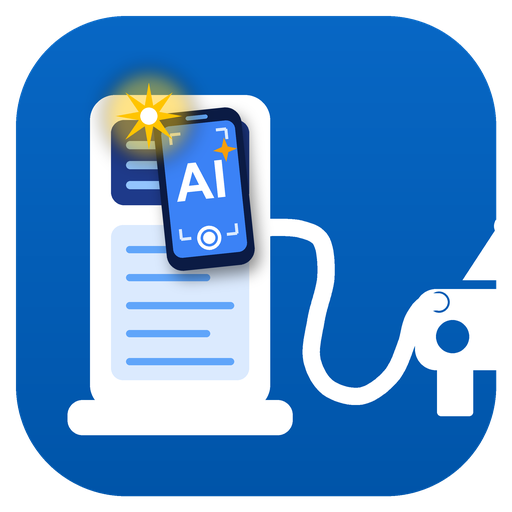
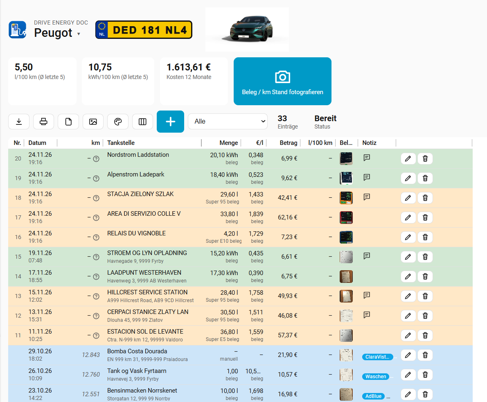
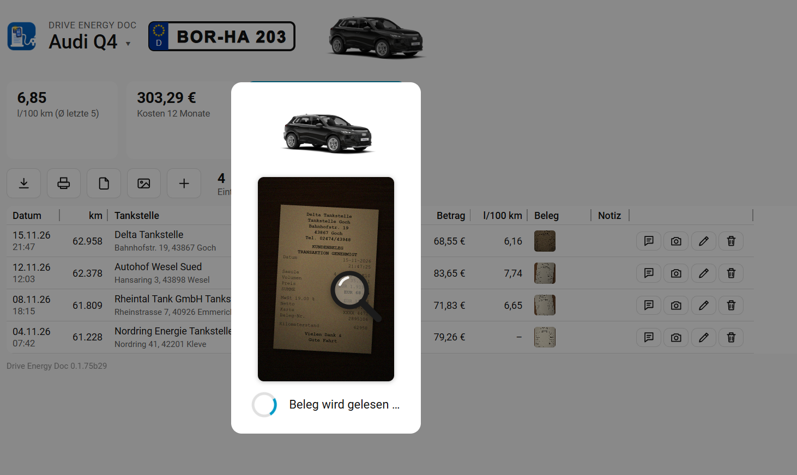
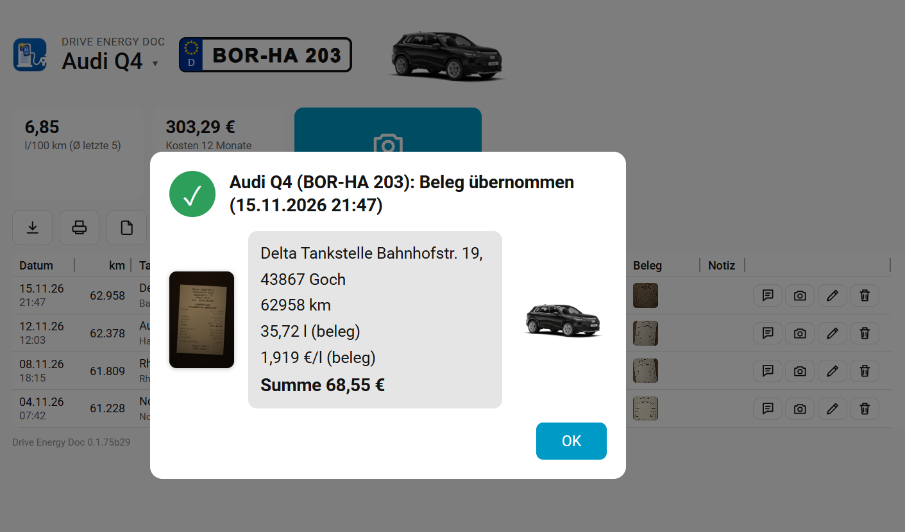
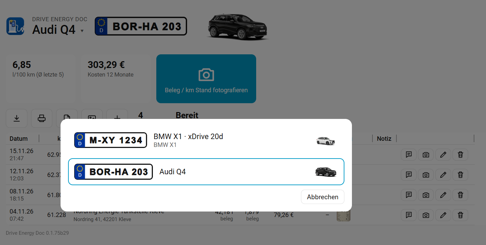

<p align="center"></p>

# Drive Energy Doc für Home Assistant

🇩🇪 Deutsch · [🇬🇧 English (below)](#english)

### Das smarte, vollautomatische Tankbuch

Ein **Tank- und Ladebuch für beliebig viele Fahrzeuge** (Verbrenner und Elektro), das sich vollautomatisch selbst führt.
Es gibt zwei Arten, es zu nutzen, die sich auch mischen lassen:

- **Mit Verbindung zum Auto (völlig automatisch):** Home Assistant erkennt das Tanken oder Laden selbst aus den Sensoren des Autos
  (Füllstand, Kilometerstand, GPS), legt den Eintrag an, holt den Preis und rechnet den Verbrauch aus. Der Fahrer muss nichts tun.
  Der Beleg ist hier nur eine Zugabe: Schickt man ihn per Telegram, liest ihn die KI, und die Abrechnung wird noch präziser
  (echte Menge, Preis und Summe) und der Vorgang zusätzlich dokumentiert.
- **Ganz ohne Verbindung zum Auto (Foto-Betrieb):** Es genügt, ein **Foto vom Tachostand** und ein **Foto von der Zapfsäule oder dem Beleg**
  per Telegram zu schicken. Die KI liest Kilometerstand, Menge, Preis und Summe, das Tankbuch wird geführt und die Belege werden archiviert.
  Dafür sind beim Fahrzeug keinerlei Sensoren nötig. Das ist **ideal für ein Flottenmanagement**: jedes Fahrzeug bekommt einen eigenen
  Telegram-Chat (z. B. mit dem Fahrer), und alle Fahrzeuge landen in einer Liste mit CSV- und PDF-Druck.

Auch **weiteres Verbrauchsmaterial** (AdBlue, Öl, Scheibenreiniger, …) lässt sich per Nachricht oder Foto dokumentieren; es zählt zu den Kosten, aber nicht zum Verbrauch.

Alles landet in einer Liste im Seitenmenü (mit CSV- und PDF-Druck).

## Inhalt
0. [Wozu das Ganze? Der Sinn des Tankbuches](#wozu-das-ganze-der-sinn-des-tankbuches) · [Die Wege ins Buch](#die-wege-daten-ins-buch-zu-bekommen)
0. [Foto-Betrieb ohne Auto-Anbindung](#foto-betrieb-ohne-auto-anbindung-flottenmanagement)
1. [So funktioniert es (Überblick)](#so-funktioniert-es-überblick)
2. [Wie ein Tanken erkannt wird (genau)](#wie-ein-tanken-erkannt-wird-genau)
3. [Welche Position und welcher Preis verwendet wird](#welche-position-und-welcher-preis-verwendet-wird)
4. [Beleg, Zubehör und Tacho per Nachricht](#beleg-zubehör-und-tacho-per-nachricht)
5. [Wie der Verbrauch berechnet wird](#wie-der-verbrauch-berechnet-wird) · [Elektrofahrzeuge](#elektrofahrzeuge)
6. [Das Panel](#das-panel)
7. [Sensoren, Ereignis und Dienste](#sensoren-ereignis-und-dienste)
8. [Installation und Einrichtung](#installation-und-einrichtung)
9. [Telegram einrichten](#telegram-einrichten) · [WhatsApp einrichten](#whatsapp-einrichten-offizielle-cloud-api-von-meta)
10. [Daten und Datenschutz](#daten-und-datenschutz)
11. [Grenzen](#grenzen) · [Tests](#tests) · [Lizenz](#lizenz)

---



*Das Panel (Beispieldaten): Fahrzeugkopf, Kennzahlen, großer Foto-Knopf und die Liste mit Belegfotos.*

<table>
<tr>
<td align="center"><br><sub>Die KI liest den Beleg (mit Lupe)</sub></td>
<td align="center"><br><sub>Ergebnis: Tankstelle, Menge, Preis, Summe</sub></td>
<td align="center"><br><sub>Fahrzeugauswahl per Klick auf den Kopfbereich</sub></td>
</tr>
</table>

## Wozu das Ganze? Der Sinn des Tankbuches

Ein Fahrtenbuch/Tankbuch beantwortet Fragen, die man sonst nur schätzt:
- **Was kostet mein Auto wirklich?** Kraftstoff bzw. Strom, dazu Zubehör (AdBlue, Öl, Wischer) – je Monat und je 12 Monate.
- **Was verbraucht es wirklich?** Voll-zu-Voll gerechnet, unabhängig vom (oft zu optimistischen) Bordcomputer; Veränderungen
  (Winterreifen, Defekt, andere Fahrweise) werden sichtbar.
- **Belege und Nachweise:** Jede Zeile kann das Foto des Bons und des Tachostandes enthalten – für Steuer, Firmenwagen,
  Garantie oder Verkauf. Liste als CSV (Excel) oder PDF zum Ausdrucken.
- **Mehrere Fahrzeuge in einem Buch**, Verbrenner und Elektro gleich behandelt, ohne Zettelwirtschaft oder Tabellen von Hand.

Der Aufwand soll dabei so klein wie möglich sein: Das Auto meldet das Tanken von selbst, du schickst höchstens noch ein Foto vom Bon.

## Die Wege, Daten ins Buch zu bekommen

| Weg | Was du tust | Was automatisch passiert |
|---|---|---|
| **1. Automatisch (Sensoren)** | nichts | Füllstand steigt → Tanken erkannt, Menge, Ort, Kilometerstand und (wenn verfügbar) Preis werden eingetragen |
| **2. Beleg-Foto per Telegram / WhatsApp / Companion** | Bon oder Zapfsäule fotografieren und dem Bot schicken | KI liest Menge/Preis/Summe/Datum, Foto wird zugeschnitten und am Eintrag gespeichert, Werte vom Beleg ersetzen die geschätzten |
| **3. Beleg als Text** | `45,93 105,13` oder `27.10. 45,93 105,13` schreiben | Werte werden dem passenden Tanken zugeordnet (ohne KI) |
| **4. Zubehör** | `+ 24,90`, `extra Öl 1 9,50`, Kurzwort `adblue` oder Foto mit Bildtext | eigener Eintrag, zählt zu den Kosten, nicht zum Verbrauch |
| **5. Tacho-Foto / `km 54210`** | Tacho fotografieren oder Text senden | Kilometerstand wird dem zeitlich passenden Tanken zugeordnet; bei Zweifeln fragt der Bot nach |
| **6. Panel** | manuellen Eintrag („+“), Eintrag bearbeiten, Fotos hochladen oder löschen | – |
| **7. Dienst** `drive_energy_doc.submit_text` | z. B. aus einer Automation oder einem Skript Text einspeisen | wie Weg 3–5 |
| **8. Import (einmalig)** | Altdaten als `config/drive_energy_doc/import/<Fahrzeugname>/entries.json` (optional mit `photos/`, `originals/`) ablegen | Einträge samt Fotos werden beim nächsten Start übernommen |

Der **Beleg hat immer Vorrang** vor dem Automatischen: Das Auto schätzt, der Bon stimmt. Alle Wege führen in dasselbe Buch;
du kannst sie beliebig mischen (z. B. automatisch erkennen lassen und nur gelegentlich den Bon schicken).

## Foto-Betrieb ohne Auto-Anbindung (Flottenmanagement)

Beim Anlegen des Fahrzeugs sind nur Name, Energieart und Tankgröße Pflicht. Lässt du Füllstand-, Kilometerstand- und GPS-Sensor leer, arbeitet
das Fahrzeug rein über Nachrichten:

1. Der Fahrer schickt dem Bot ein **Foto vom Tacho** (oder `km 54210` als Text). Es wird ein neuer Eintrag mit diesem Kilometerstand angelegt.
2. Danach schickt er das **Foto vom Beleg oder der Zapfsäule** (bis 48 Stunden später). Die KI liest Menge, Preis, Summe und Datum, das Foto
   wird zugeschnitten und am Eintrag archiviert. Die Reihenfolge ist egal: kommt der Beleg zuerst, legt er den Eintrag an, der Tacho ergänzt ihn.
3. Zubehör (AdBlue, Öl …) geht genauso mit `+ 24,90` oder per Foto mit Bildtext.

Der Verbrauch (Voll-zu-Voll) wird aus den Kilometerständen und Mengen berechnet. Weil ohne Sensoren nicht bekannt ist, ob voll getankt wurde, gilt
jedes Tanken als voll. Für eine **Flotte** legst du je Fahrzeug einen eigenen Eintrag mit eigenem Telegram-Chat an; die Zuordnung läuft über die Chat-ID.

---

## So funktioniert es (Überblick)

```
Auto-Sensoren (Füllstand %, Kilometerstand, GPS)
        │
        ▼
 Erkennung: Füllstand steigt → Tanken läuft → Ruhe + Abstand → "fertig"
        │
        ├─► Preis nachschlagen (Tankstellen-Dienst, optional)
        ├─► Eintrag im Buch anlegen (Zeit, Menge, Preis, Kosten, Kilometerstand, Ort)
        └─► Nachricht per Telegram/WhatsApp/Companion-App: "Tanken erkannt – Beleg bei Bedarf nachreichen"
                   │
                   ▼
        Foto vom Bon / Zapfsäule / Text  ─►  KI liest Menge, Preis, Summe, Datum
                   │                         (Foto wird zugeschnitten und am Eintrag gespeichert)
                   ▼
        Der Beleg gewinnt immer: seine Werte ersetzen die geschätzten
```

Jedes Fahrzeug ist ein eigener Eintrag in der Integration. Daneben gibt es einen Eintrag **„Globale Einstellungen“**
für Dinge, die für alle Fahrzeuge gleich sind (Preisquellen, Strompreis, KI-Auswahl, Telegram/WhatsApp-Zugänge).
Jedes Fahrzeug hat seine eigene Konfiguration (Sensoren, Kraftstoffart, Schwellwerte, Chat), sein eigenes Buch und eigene Sensoren.

## Wie ein Tanken erkannt wird (genau)

Die Erkennung läuft als kleiner Automat, der bei jeder Änderung des **Füllstand-Sensors** (in %) arbeitet und alle 15 Sekunden
zusätzlich die Zeit prüft. Es sind vier Zustände:

1. **Ruhe.** Es passiert nichts, solange der Füllstand gleich bleibt oder sinkt (Fahren verbraucht Kraftstoff).
2. **Kandidat.** Sobald der Füllstand **steigt**, merkt sich die Integration den Wert davor (`Füllstand von`), den Zeitpunkt und die
   **Position**. Weitere Anstiege werden zu *einem* Vorgang aufaddiert (viele Autos melden die Füllung in mehreren kleinen Schritten).
3. **Gültig.** Sobald der Gesamtzuwachs **mindestens 5 %** erreicht (einstellbar), gilt der Vorgang als echtes Tanken. Kleinere
   Schwankungen (Lagesensor, Bergfahrt, Messrauschen) werden so ignoriert. Ab hier wird der Preis geholt (siehe unten).
4. **Fertig.** Das Tanken wird abgeschlossen, wenn **beides** zutrifft:
   - der Füllstand ist **60 Sekunden lang nicht weiter gestiegen** (einstellbar), und
   - das Auto ist **mehr als 250 m vom Tankort entfernt** (einstellbar, per Luftlinie zur Startposition).

   Warum der Abstand? Der Füllstand steigt oft verzögert; wer noch an der Zapfsäule steht, soll nicht schon einen Eintrag auslösen.
   Erst wenn das Auto losgefahren ist, steht fest, dass das Tanken beendet ist. Erst dann kommt die Nachricht, in der du bei Bedarf den Beleg nachreichen kannst (optional; der Eintrag ist auch ohne Beleg vollständig).

   **Ausnahme Elektroauto:** Hier entfällt die Entfernungsbedingung (das Auto bleibt beim Laden stehen). Standard ist **10 Minuten
   Ruhe** ohne weiteren Anstieg; auch das ist einstellbar. Die Abstandsregel lässt sich auch bei Verbrennern abschalten.

**Abbruch.** Wird der Zuwachs nach 10 Minuten nicht mehr größer und nie gültig (unter der Schwelle), wird der Kandidat verworfen.
Läuft Home Assistant gerade neu an, bleibt ein angefangener Vorgang erhalten (er wird gespeichert) und wird danach weitergeführt.

**Was im Eintrag landet:** Zeitpunkt, Füllstand von/bis, daraus die Menge (Zuwachs × Tankvolumen bzw. Akkukapazität),
Kilometerstand (aus dem Tacho-Sensor, falls vorhanden), Ort und der Preis (falls verfügbar). Ein Tankvolumen wird dafür einmal
beim Fahrzeug eingetragen.

## Welche Position und welcher Preis verwendet wird

**Position:** Es zählt die **zuletzt bekannte GPS-Position des Fahrzeugs (`device_tracker`) in dem Moment, in dem der erste
Füllstand-Anstieg eintrifft**. Das Auto steht dann an der Zapfsäule. Wichtig: Meldet das Auto den neuen Füllstand erst spät, kann die
zuletzt gemeldete Position noch vom Vorweg stammen. Dann zeigt der Eintrag den falschen Ort und der Preis kommt von der falschen
Tankstelle – der Beleg korrigiert den Preis in jedem Fall.

**Preis:** Optional. Beim Übergang zu „gültig“ sucht die Integration mit der Startposition die **nächste geöffnete Tankstelle im
Umkreis von 400 m** und nimmt den Preis der gewählten Kraftstoffart (Diesel, E5, E10). Quellen:

| Land | Dienst | Schlüssel |
|---|---|---|
| Deutschland | Tankerkönig | persönlicher, kostenloser API-Schlüssel |
| Österreich | E-Control | keiner nötig |
| Frankreich | prix-carburants (data.gouv.fr) | keiner nötig |

Die Quelle richtet sich nach dem Land der Position (oder fest gewählt). Ohne jede Quelle funktioniert alles weiter; dann kommt der Preis
vom Beleg. **Elektro:** fester Preis je kWh oder ein Sensor/Helfer, der den Strompreis liefert (z. B. dynamischer Tarif).

**Der Beleg hat immer Vorrang.** Menge, Preis und Summe vom Beleg überschreiben die geschätzten Werte. Ein Eintrag ist erst dann
als „Beleg geprüft“ markiert, wenn mindestens Menge, Preis oder Summe vom Beleg kamen.

## Beleg, Zubehör und Tacho per Nachricht

Die Nachrichten laufen über **Telegram** (eigener Bot, empfohlen), **WhatsApp** (Cloud-API von Meta) oder die **Companion-App**
(Push-Nachricht; Foto-Upload dann im Panel). Pro Fahrzeug wählst du, welche Kanäle genutzt werden. Mit `?`, `h`, `help` oder `hilfe`
(auch `/help`, `/start`, oder das Wort für „Hilfe“ in der eigenen Sprache) zeigt der Bot alle Kommandos.

### Beleg zum Tanken
- **Foto** vom Bon oder von der Zapfsäule schicken. Die KI liest Menge, Preis, Summe, Datum und – falls sichtbar – den Kilometerstand.
  Das Foto wird **auf den Beleg zugeschnitten** (die KI nennt den Rahmen; ohne KI-Antwort greift eine einfache Erkennung hochformatiger,
  heller Papierbons). Das Original bleibt gesichert und ist im Panel einsehbar.
- **Text:** `45,93 105,13` (Menge Betrag), `45,93 2,289 105,13` (Menge Preis Betrag) oder mit Datum davor `27.10. 45,93 105,13`.
- **Weiteres Foto** zum letzten Tanken: Foto mit dem Wort `zusatz` im Bildtext.
- Ist ein Wert unplausibel oder nicht lesbar, antwortet der Bot mit einem Hinweis statt etwas Falsches zu speichern.

### Zubehör (AdBlue, Öl, Scheibenwischer …)
Alles, was Geld kostet, aber kein Kraftstoff ist. Kennwort **`+`, `e`, `x`, `extra`, `z`, `zub`** oder `zubehör`, danach optional die
Bezeichnung und die Zahlen: `+ 24,90`, `extra Öl 1 9,50`, `z Scheibenwischer 24,90`. Erlaubt sind nur Betrag, Menge Betrag oder Menge
Preis Betrag, optional mit Datum. Kurzwörter ohne Kennwort: `adblue`, `öl`, `scheibenwischer`, `scheibenwasser`, `frostschutz`.
Dasselbe als Bildtext zu einem Foto hängt den Beleg an den Eintrag. Zubehör erscheint als eigene Zeile, zählt zu den Kosten,
aber **nicht** in den Verbrauch.

### Tacho-Kilometerstand
Foto vom Tacho oder Text wie `km 54210` senden. Der Wert wird dem Tankvorgang zugeordnet, dessen Zeit der Sendezeit am nächsten liegt
(Fenster 24 Stunden). Bei großer Abweichung vom gespeicherten Stand (> 300 km), einem Wert kleiner als beim vorigen Tanken oder
einem zu alten Tankvorgang fragt der Bot nach und wartet auf deine Bestätigung (`ja`).
Zusätzlich prüft er den **Verbrauch**: Ergeben der neue Stand, die getankte Menge (plus Teilbetankungen dazwischen) und die Kilometer seit dem letzten vollen Tanken einen Verbrauch, der mehr als 40 % vom Durchschnitt der letzten fünf Voll-zu-Voll-Werte abweicht, warnt er (z. B. „würde bei 200 km seit dem letzten Tanken 24,5 l/100 km ergeben, Durchschnitt 7,0 l/100 km“) und fragt, ob der Stand trotzdem übernommen werden soll (`ja` oder `nein`). Dieselbe Warnung steht unter einem Beleg, dessen Kilometerstand unplausibel wirkt. Die Prüfung braucht mindestens zwei frühere Verbrauchswerte und gilt nur für volle Betankungen.

## Wie der Verbrauch berechnet wird

Methode **Voll-zu-Voll**: Ein Tanken zählt als „voll“, wenn der Zuwachs **mindestens 30 %** beträgt. Zwischen zwei vollen Tanken
werden alle getankten Mengen addiert und durch die gefahrenen Kilometer geteilt (Ergebnis je 100 km bzw. kWh/100 km).
Teilbetankungen zeigen daher keinen eigenen Verbrauch, fließen aber in die nächste volle Rechnung ein. Zubehör zählt nicht.
Ist über den Zuwachs nichts bekannt (z. B. von Hand angelegt), gilt das Tanken als voll. Ohne Kilometerstand gibt es keine Rechnung.

## Elektrofahrzeuge

Elektroautos funktionieren genauso wie Verbrenner; die Unterschiede im Überblick:

**Einrichtung:** Beim Fahrzeug die Energieart **Elektro** wählen und als Kapazität die **nutzbare Akkukapazität in kWh** eintragen (z. B. 58). Als Füllstand-Sensor dient der **Ladezustand (SoC) in %**, optional Kilometerstand und GPS wie beim Verbrenner. Ohne Sensoren funktioniert auch hier der [Foto-Betrieb](#foto-betrieb-ohne-auto-anbindung-flottenmanagement) (z. B. Foto der Ladesäule oder der App-Rechnung).

**Erkennung:** Steigt der Ladezustand um mindestens **5 %**, wird ein Ladevorgang erkannt. Er ist beendet, wenn der Ladezustand **10 Minuten lang nicht weiter gestiegen** ist (Standard, einstellbar unter *Konfigurieren → Tankerkennung (Feintuning)*). Die **Entfernungsbedingung entfällt** (das Auto steht ja beim Laden), lässt sich aber einschalten. Viele kleine Ladungen am Tag werden einzeln als Vorgänge erfasst, sobald sie die 5 % erreichen.

**Menge:** kWh = Zuwachs in % × Akkukapazität. Das ist die Energie **im Akku**; an der Steckdose oder Wallbox wird wegen der Ladeverluste meist etwas mehr verbraucht. Willst du es genau, schick den Wert vom Beleg oder der Ladesäule (z. B. `38,2 0,39 14,90`); der Beleg hat immer Vorrang.

**Preis:** Es gibt keine Tankstellensuche. Stattdessen nimmt die Integration den **Strompreis je kWh** aus den *Globalen Einstellungen*: eine feste Zahl (z. B. `0,32`) oder eine Entität, die den aktuellen Preis liefert (z. B. dynamischer Tarif, Helfer oder Sensor). So bekommt jedes Laden **zu Hause** automatisch Preis und Kosten. Beim **öffentlichen Laden** schickst du die App-Rechnung oder ein Foto der Ladesäule per Telegram; die KI liest kWh, Preis und Summe, und der Beleg ersetzt den eingestellten Preis.

**Verbrauch:** Gerechnet wird wie beim Verbrenner nach Voll-zu-Voll, Ergebnis in **kWh/100 km**. Als „voll“ gilt ein Ladevorgang ab **30 %** Zuwachs; kleinere Ladungen werden bis zur nächsten größeren aufaddiert. Dafür braucht es Kilometerstände (Sensor, Tacho-Foto oder `km 54210`).

**Bekannte Grenzen:** Der Wallbox-Zähler wird (noch) nicht gelesen, die Menge ist akkuseitig. Meldet das Auto den Ladezustand nur alle paar Minuten, startet und endet ein Vorgang entsprechend verzögert. Zeigt der Ladezustand nur ganze Prozent, sind sehr kleine Ladungen ungenau.

## Das Panel

Nach der Einrichtung erscheint das Panel in der Seitenleiste, benannt nach der Systemsprache von Home Assistant (Deutsch **„Tankbuch“**, Englisch „Fuel log“, Französisch „Carnet de carburant“ …):
- Liste aller Tanken/Ladungen und Zubehör je Fahrzeug, Spalten verschiebbar und in der Breite änderbar.
- Kennzeichen-Darstellung (alle europäischen Länder, EU-Ring bzw. gelb für NL/GB), Fahrzeugbild und -typ in der Kopfzeile. Bei mehreren Fahrzeugen öffnet ein Klick auf den Kopfbereich (Logo, Fahrzeugtyp, Kennzeichen) einen Auswahldialog mit allen Fahrzeugen. Kennzeichen und Land stellst du in der Konfiguration des Fahrzeugs ein.
- Belegfotos und Tacho-Fotos mit Vorschau beim Überfahren, Löschen mit Rückfrage; Foto-Upload.
- Bearbeiten, manueller Eintrag („+“), Ort mit kleiner Google-Maps-Verknüpfung.
- **CSV-Export** (Excel-tauglich) und **Druck/PDF** (Hoch- oder Querformat, mit oder ohne Belege).

## Sensoren, Ereignis und Dienste

Je Fahrzeug: **Status**, **letztes Tanken**, **letzter Preis**, **Verbrauch** (Ø der letzten 5, Voll-zu-Voll), **Kosten 12 Monate**.
Bei jedem erkannten Tanken wird das Ereignis `drive_energy_doc_refuel` ausgelöst (für eigene Automationen).
Dienste: `drive_energy_doc.export_csv` (schreibt `config/drive_energy_doc/<Name>.csv`), `drive_energy_doc.submit_text` (Text wie eine
Nachricht einspeisen) und `drive_energy_doc.test_message`.

## Installation und Einrichtung

**Marketplace / HACS:** Im Marketplace von Home Assistant (ab 2026.11; vorher in HACS) das Repository `AlphaLima/ha-drive-energy-doc` als benutzerdefiniertes Repository hinzufügen (Typ *Integration*; dafür wird ein GitHub-Konto verbunden), installieren, HA neu starten. Updates erscheinen dort, sobald ein neues Release veröffentlicht ist; Beta-Versionen sieht nur, wer Vorabversionen anzeigen lässt. **Manuell:** den Ordner `custom_components/drive_energy_doc` nach `config/custom_components/` kopieren,
HA neu starten.

Dann *Einstellungen → Geräte & Dienste → Integration hinzufügen → Drive Energy Doc*:

1. **Globale Einstellungen** anlegen: Preisquelle (automatisch nach Land oder fest), Tankerkönig-Schlüssel (nur für Deutschland),
   Strompreis, KI (leer = Gemini automatisch, sonst eine `ai_task`-Entität), Nachrichtenkanäle (Companion, Telegram, WhatsApp; WhatsApp-Zugangsdaten stehen ebenfalls hier, der Telegram-Token wird dagegen beim Fahrzeug eingetragen).
2. **Fahrzeug hinzufügen:** Pflicht sind nur Name, Energieart (Diesel/E5/E10/Elektro) und Tankvolumen bzw. Akkukapazität.
   **Optional:** Füllstand-Sensor (in %), Kilometerstand-Sensor, `device_tracker`. Ohne diese Sensoren gibt es keine automatische
   Erkennung; Einträge entstehen dann nur per Foto/Text oder im Panel, und jeder Beleg ohne passenden Eintrag legt automatisch
   einen neuen an (reiner Foto-Betrieb). Ebenfalls optional: Kennzeichen und Land (vor dem Speichern siehst du das gezeichnete Schild), Fahrzeugtyp, Sprache der Bot-Antworten, Fahrzeugbild, Telegram-Chat.
3. Schwellwerte (5 %, 60 s, 250 m) und Nachrichtenkanäle sind je Fahrzeug unter *Konfigurieren* änderbar.

Voraussetzungen: Home Assistant ab 2025.8; für das Lesen von Belegen eine `ai_task`-Integration (Gemini, OpenAI, Anthropic …).

## Telegram einrichten
Telegram ist der einfachste Kanal: kostenlos, ohne Firmenkonto und ohne öffentlich erreichbares Home Assistant (die Integration fragt Telegram selbst ab).

**Du brauchst:** ein Telegram-Konto und etwa fünf Minuten.

1. **Bot anlegen.** In Telegram den Kontakt **@BotFather** öffnen, `/newbot` senden, einen Anzeigenamen und einen Benutzernamen (muss auf `bot` enden) wählen. BotFather antwortet mit dem **Token** (sieht aus wie `123456789:ABC…`). Der Token ist wie ein Passwort: nicht weitergeben, nicht in Screenshots zeigen.
2. **Kanal freischalten (einmalig).** *Einstellungen → Geräte & Dienste → Drive Energy Doc → „Drive Energy Doc Einstellungen“ → Konfigurieren → Kanäle, Preisquelle, KI* und bei den Kanälen **Telegram** ankreuzen.
3. **Chat-ID herausfinden.** Dem neuen Bot in Telegram eine Nachricht schreiben (z. B. `/start`). Dann im Browser `https://api.telegram.org/bot<TOKEN>/getUpdates` öffnen (statt `<TOKEN>` deinen Token einsetzen) und die Zahl hinter `"chat":{"id":` suchen. Das ist die Chat-ID (in Gruppen negativ). Ist der Bot schon bei einem anderen Fahrzeug eingetragen, antwortet er auf `/start` aus einem neuen Chat von selbst mit der Chat-ID.
4. **Beim Fahrzeug eintragen.** *Drive Energy Doc → Fahrzeug → Konfigurieren → Kommunikation → Telegram*: **Bot-Token** und **Chat-ID** eintragen. Mit dem Schalter **„Testnachricht senden“** prüfst du sofort, ob alles stimmt: die Nachricht kommt im Chat an und als Benachrichtigung in Home Assistant.
5. **Benutzen.** Dem Bot Beleg-Fotos, Tacho-Fotos oder Text schicken (siehe [Beleg, Zubehör und Tacho per Nachricht](#beleg-zubehör-und-tacho-per-nachricht)). Mit `?` listet er alle Kommandos.

**Mehrere Fahrzeuge oder Fahrer (Flotte):** Du kannst **einen** Bot für alle Fahrzeuge nutzen. Jedes Fahrzeug bekommt dann eine **eigene Chat-ID**: jeder Fahrer schreibt dem Bot in seinem eigenen Chat, oder du legst je Fahrzeug eine Gruppe an und fügst den Bot hinzu. Die Zuordnung zum Fahrzeug läuft allein über die Chat-ID. Alternativ legst du je Fahrzeug einen eigenen Bot an.

**Wenn nichts ankommt:**
- Antwortet der Bot gar nicht: Token prüfen, und ob ein **zweites Programm** denselben Token abfragt (Node-RED, `telegram_bot` mit Polling, ein zweites Home Assistant). Ein Token darf nur von **einem** Programm abgefragt werden.
- Schreibt der Bot, dass die Chat-ID „keinem Fahrzeug zugeordnet“ ist: Zahl beim richtigen Fahrzeug eintragen.
- In **Gruppen** kommen Fotos beim Bot nur an, wenn sein Datenschutzmodus aus ist: bei @BotFather `/setprivacy` → Bot wählen → **Disable**, danach den Bot aus der Gruppe entfernen und neu hinzufügen.
- Fremde Chats werden nie verarbeitet; es werden nur Nachrichten der eingetragenen Chat-ID angenommen.

## WhatsApp einrichten (offizielle Cloud API von Meta)
WhatsApp ist aufwendiger als Telegram, aber praktisch, wenn die Fahrer WhatsApp ohnehin nutzen. Es wird die **offizielle WhatsApp Cloud API von Meta** verwendet.

**Du brauchst:**
- ein Meta-Entwicklerkonto (developers.facebook.com) und eine App vom Typ „Business“ mit dem Produkt „WhatsApp“,
- eine **Telefonnummer** für den Bot: zum Ausprobieren stellt Meta eine Testnummer bereit (Empfänger müssen dort vorher eingetragen werden), für den echten Betrieb eine eigene, bei WhatsApp registrierte Nummer,
- Home Assistant muss **aus dem Internet per HTTPS** erreichbar sein, und zwar ohne Anmeldung unter `/api/drive_energy_doc/whatsapp` (z. B. Nabu Casa, Tailscale Funnel, Cloudflare Tunnel oder ein Reverse Proxy). Meta ruft diese Adresse auf, sobald eine Nachricht eintrifft.

**Schritte:**
1. In der Meta-App unter *WhatsApp → API-Einrichtung* die **Telefonnummer-ID** notieren und einen **dauerhaften Zugriffstoken** erzeugen (über einen Systemnutzer im Business-Manager; der vorläufige Token läuft nach 24 Stunden ab). Das **App-Secret** steht unter *App-Einstellungen → Allgemein*.
2. In Home Assistant *Drive Energy Doc → „Drive Energy Doc Einstellungen“ → Konfigurieren → WhatsApp-Zugang*: Token, Telefonnummer-ID, ein **frei gewähltes Verify-Token** und das App-Secret eintragen. Ohne App-Secret verarbeitet die Integration eingehende Nachrichten nicht (die Herkunft kann dann nicht geprüft werden). Bei den Kanälen (*Kanäle, Preisquelle, KI*) **WhatsApp** ankreuzen.
3. In der Meta-App unter *WhatsApp → Konfiguration → Webhook* eintragen: Callback-URL `https://<deine-öffentliche-HA-Adresse>/api/drive_energy_doc/whatsapp`, dasselbe **Verify-Token**, und das Feld **`messages`** abonnieren.
4. Beim Fahrzeug (*Konfigurieren → Kommunikation → WhatsApp*) die **Nummer des Fahrers** eintragen, mit Landesvorwahl, ohne `+` und Leerzeichen (z. B. `4917012345678`). Nur Nachrichten dieser Nummer werden angenommen. Mit dem Schalter „Testnachricht senden“ prüfst du den Weg.
5. **Wichtig, 24-Stunden-Regel:** WhatsApp erlaubt Nachrichten von sich aus (z. B. „Tanken erkannt“) nur innerhalb von 24 Stunden nach der letzten Nachricht des Fahrers. Danach geht nur eine von Meta **freigegebene Vorlage** (Kategorie *Utility*) mit einem Text wie `Drive Energy Doc: {{1}}`. Den Vorlagennamen und den Sprachcode trägst du in den WhatsApp-Einstellungen ein. Ohne Vorlage kommt die Meldung nur im offenen Fenster an. Antworten auf Nachrichten des Fahrers sind immer möglich.

Hinweis: Preise und Regeln von Meta ändern sich; informiere dich bei Meta über Kosten für Vorlagen-Nachrichten und die Anforderungen an das Business-Konto.

## Sprachen
Panel und Bot sprechen **36 Sprachen**: Deutsch, Englisch, Französisch, Spanisch, Italienisch, Niederländisch, Portugiesisch, Polnisch, Tschechisch, Slowakisch, Slowenisch, Kroatisch, Serbisch, Bosnisch, Mazedonisch, Bulgarisch, Ukrainisch, Belarussisch, **Russisch**, Rumänisch, Ungarisch, Griechisch, Türkisch, Albanisch, Litauisch, Lettisch, Estnisch, Finnisch, Schwedisch, Dänisch, Norwegisch, Isländisch, Irisch, Maltesisch, Luxemburgisch und Katalanisch.
- **Panel:** folgt automatisch der Sprache des angemeldeten HA-Benutzers; ist sie nicht dabei, erscheint Englisch.
- **Bot-Antworten:** je Fahrzeug einstellbar (*Konfigurieren → Fahrzeug*, Feld „Sprache der Bot-Antworten“), Standard ist die Sprache von Home Assistant. So kann jedes Fahrzeug einer Flotte in der Sprache seines Fahrers antworten.
- **Kommandos:** `?`, `help`, `extra`, `+`, `ja`/`nein`/`neu` und die Kurzwörter für Verbrauchsmaterial werden in **allen** Sprachen verstanden, unabhängig von der Antwortsprache.
- Die Einrichtungsdialoge in Home Assistant gibt es auf Deutsch und Englisch (andere Sprachen fallen auf Englisch zurück).
- Die Übersetzungen sind mit KI-Unterstützung entstanden; Korrekturen sind als Issue oder Pull Request willkommen (Dateien in `custom_components/drive_energy_doc/frontend/i18n/`).

## Daten und Datenschutz
- Alle Einträge und Fotos liegen **lokal** in deiner HA-Installation (`.storage` und `config/drive_energy_doc/`). Es gibt keinen Server des Autors.
- Nach außen gehen nur: die Preisabfrage (Position ≈ Tankstellen-Umkreis an den Preisdienst), Nachrichten an Telegram/WhatsApp, und Belegfotos an die
  von dir gewählte KI (`ai_task`).
- Tokens und Schlüssel stehen in der Konfiguration der Integration; teile Diagnosen oder Backups nicht ungeprüft.

## Grenzen
- Der Füllstand muss in **Prozent** vorliegen.
- Die Genauigkeit des Ortes hängt davon ab, wie schnell das Auto Füllstand und Position meldet (siehe oben).
- Die Integration ist noch jung (0.1.x); bitte Fehler als Issue melden.

## Tests
`python tests/test_detector.py`, `test_receipt.py`, `test_stats.py`, `test_plate.py` (ohne Home Assistant).

Zum Ausprobieren liegen unter `tests/test_images/` **20 frei erfundene Foto-Paare** (Beleg und Tacho, von gut bis schlecht lesbar) mit den richtigen Werten in CSV-Dateien, siehe [tests/test_images](tests/test_images/README.md).

## Lizenz
MIT

---

<a id="english"></a>

# Drive Energy Doc for Home Assistant (English)

### The smart, fully automatic fuel and charging log

A **fuel and charging log for any number of vehicles** (combustion and electric) that keeps itself fully automatically. There are two ways to use it, and you can mix them:

- **Connected to the car (fully automatic):** Home Assistant detects refuelling or charging on its own from the car's sensors (level, odometer, GPS), creates the entry, looks up the price and calculates the consumption. The driver does not have to do anything. The receipt is only a bonus: if it is sent via Telegram, the AI reads it, the accounting becomes even more precise (real quantity, price and total) and the event is documented as well.
- **Without any connection to the car (photo mode):** Just send a **photo of the odometer** and a **photo of the pump or the receipt** via Telegram. The AI reads mileage, quantity, price and total, the log is kept and the receipts are archived. No sensors are needed for the vehicle. This is **ideal for fleet management**: every vehicle gets its own Telegram chat (e.g. with the driver), and all vehicles end up in one list with CSV and PDF export.

**Other consumables** (AdBlue, oil, washer fluid, …) can be documented as well, by message or photo; they count towards costs but not towards consumption.

Everything ends up in one list in the sidebar (with CSV and PDF printing).


*The panel (sample data): vehicle header, key figures, big photo button and the list with receipt photos.*

<table>
<tr>
<td align="center"><br><sub>The AI reads the receipt (with magnifier)</sub></td>
<td align="center"><br><sub>Result: station, quantity, price, total</sub></td>
<td align="center"><br><sub>Choose a vehicle by clicking the header area</sub></td>
</tr>
</table>

## What is it for?

A fuel log answers questions you would otherwise only guess:
- **What does my car really cost?** Fuel or electricity plus accessories (AdBlue, oil, wipers), per month and over 12 months.
- **What does it really consume?** Calculated full-to-full, independent of the (often too optimistic) trip computer; changes (winter tyres, a defect, a different driving style) become visible.
- **Receipts and proof:** Each row can hold the photo of the receipt and of the odometer, for tax, company cars, warranty or resale. The list can be exported as CSV (Excel) or printed as PDF.
- **Several vehicles in one log**, combustion and electric treated the same, without paperwork or hand-made spreadsheets.

The effort is kept as small as possible: the car reports the refuelling by itself, and at most you send a photo of the receipt.

## Ways to get data into the log

| Way | What you do | What happens automatically |
|---|---|---|
| **1. Automatic (sensors)** | nothing | Level rises, refuelling is detected; quantity, place, odometer and (if available) price are recorded |
| **2. Receipt photo via Telegram / WhatsApp / Companion** | photograph the receipt or pump and send it to the bot | AI reads quantity/price/total/date, the photo is cropped and stored with the entry, receipt values replace the estimated ones |
| **3. Receipt as text** | write `45,93 105,13` or `27.10. 45,93 105,13` | values are assigned to the matching refuelling (no AI) |
| **4. Accessories** | `+ 24,90`, `extra Öl 1 9,50`, short word `adblue`, or a photo with a caption | own entry, counts towards costs, not towards consumption |
| **5. Odometer photo / `km 54210`** | photograph the odometer or send text | mileage is assigned to the refuelling that fits in time; the bot asks if in doubt |
| **6. Panel** | manual entry ("+"), edit an entry, upload or delete photos | – |
| **7. Service** `drive_energy_doc.submit_text` | feed text in, e.g. from an automation or script | like ways 3–5 |
| **8. Import (one-off)** | put old data at `config/drive_energy_doc/import/<vehicle name>/entries.json` (optionally with `photos/`, `originals/`) | entries including photos are taken over at the next start |

The **receipt always wins** over the automatic values: the car estimates, the receipt is right. All ways lead into the same log; mix them as you like.

## Photo mode without a car connection (fleet management)

When adding the vehicle, only name, energy type and tank size are required. If you leave the level, odometer and GPS sensors empty, the vehicle works purely through messages:

1. The driver sends the bot a **photo of the odometer** (or `km 54210` as text). A new entry with this mileage is created.
2. Then they send the **photo of the receipt or the pump** (up to 48 hours later). The AI reads quantity, price, total and date; the photo is cropped and archived with the entry. The order does not matter: if the receipt comes first it creates the entry and the odometer completes it.
3. Accessories (AdBlue, oil …) work the same way with `+ 24,90` or a photo with a caption.

Consumption (full-to-full) is calculated from the mileages and quantities. Because without sensors it is not known whether the tank was filled up, every refuelling counts as full. For a **fleet**, create one entry per vehicle with its own Telegram chat; the assignment is done via the chat ID.

## How it works (overview)

```
Car sensors (level %, odometer, GPS)
        │
        ▼
 Detection: level rises → refuelling → quiet + distance → "done"
        │
        ├─► look up the price (fuel price service, optional)
        ├─► create the log entry (time, quantity, price, cost, odometer, place)
        └─► message via Telegram/WhatsApp/Companion app: "Refuelling detected – send the receipt if you like"
                   │
                   ▼
        Photo of receipt / pump / text  ─►  AI reads quantity, price, total, date
                   │                         (photo is cropped and stored with the entry)
                   ▼
        The receipt always wins: its values replace the estimated ones
```

Each vehicle is its own entry in the integration. In addition there is one **"Global settings"** entry for everything that is the same for all vehicles (price sources, electricity price, AI choice, Telegram/WhatsApp credentials). Each vehicle has its own configuration (sensors, fuel type, thresholds, chat), its own log and its own sensors.

## How a refuelling is detected (in detail)

The detection is a small state machine. It runs on every change of the **level sensor** (in %) and additionally checks the time every 15 seconds. There are four states:

1. **Idle.** Nothing happens while the level stays the same or falls (driving uses fuel).
2. **Candidate.** As soon as the level **rises**, the integration remembers the value before it (`level from`), the time and the **position**. Further rises are added up into *one* event (many cars report the fill in several small steps).
3. **Valid.** Once the total increase reaches **at least 5 %** (adjustable), the event counts as a real refuelling. Smaller fluctuations (tilt sensor, hills, noise) are ignored this way. From here on the price is fetched (see below).
4. **Done.** The refuelling is completed when **both** are true:
   - the level has **not risen further for 60 seconds** (adjustable), and
   - the car is **more than 250 m away from the filling place** (adjustable, straight-line distance to the start position).

   Why the distance? The level often rises with a delay; someone still standing at the pump should not trigger an entry yet. Only when the car has driven away is it certain that the refuelling is over. Only then does the message arrive in which you can submit the receipt if you like (optional; the entry is complete even without a receipt).

   **Exception, electric cars:** the distance condition does not apply (the car stays put while charging). The default is **10 minutes of quiet** without a further rise; this is adjustable too. The distance rule can also be switched off for combustion cars.

**Cancel.** If the increase does not grow after 10 minutes and never becomes valid (below the threshold), the candidate is discarded. If Home Assistant restarts meanwhile, an event in progress is kept (it is stored) and continued afterwards.

**What ends up in the entry:** time, level from/to, from that the quantity (increase × tank volume or battery capacity), mileage (from the odometer sensor, if present), place and the price (if available). The tank volume is entered once per vehicle.

## Which position and which price is used

**Position:** The **last known GPS position of the vehicle (`device_tracker`) at the moment the first level rise arrives** is used. The car is then standing at the pump. Important: if the car reports the new level late, the last reported position may still be from the way there. The entry then shows the wrong place and the price comes from the wrong station; the receipt corrects the price in any case.

**Price:** Optional. At the transition to "valid" the integration uses the start position to find the **nearest open station within 400 m** and takes the price of the chosen fuel type (diesel, E5, E10). Sources:

| Country | Service | Key |
|---|---|---|
| Germany | Tankerkönig | personal, free API key |
| Austria | E-Control | none needed |
| France | prix-carburants (data.gouv.fr) | none needed |

The source depends on the country of the position (or is fixed by choice). Without any source everything still works; the price then comes from the receipt. **Electric:** a fixed price per kWh or a sensor/helper that supplies the electricity price (e.g. a dynamic tariff).

**The receipt always wins.** Quantity, price and total from the receipt overwrite the estimated values. An entry is only marked as "receipt checked" when at least quantity, price or total came from the receipt.

## Receipt, accessories and odometer by message

Messages run via **Telegram** (own bot, recommended), **WhatsApp** (Meta Cloud API) or the **Companion app** (push message; photo upload then in the panel). Per vehicle you choose which channels are used. With `?`, `h`, `help` or `hilfe` (also `/help`, `/start`) the bot lists all commands. Replies and keywords work in many languages (see *Languages*).

### Receipt for refuelling
- Send a **photo** of the receipt or the pump. The AI reads quantity, price, total, date and, if visible, the mileage. The photo is **cropped to the receipt** (the AI gives the frame; without an AI answer a simple detection of tall, bright paper receipts takes over). The original is kept and can be viewed in the panel.
- **Text:** `45,93 105,13` (quantity amount), `45,93 2,289 105,13` (quantity price amount) or with a date in front `27.10. 45,93 105,13`.
- **Another photo** for the last refuelling: a photo with the word `zusatz` in the caption.
- If a value is implausible or unreadable, the bot replies with a note instead of saving something wrong.

### Accessories (AdBlue, oil, wipers …)
Anything that costs money but is not fuel. Keyword **`+`, `e`, `x`, `extra`, `z`, `zub`** or `zubehör`, then optionally the name and the numbers: `+ 24,90`, `extra Öl 1 9,50`, `z Scheibenwischer 24,90`. Allowed are only amount, quantity amount or quantity price amount, optionally with a date. Short words without a keyword: `adblue`, `öl`, `scheibenwischer`, `scheibenwasser`, `frostschutz`. The same as the caption of a photo attaches the receipt to the entry. Accessories appear as their own row and count towards costs, but **not** towards consumption.

### Odometer reading
Send a photo of the odometer or text such as `km 54210`. The value is assigned to the refuelling whose time is closest to the sending time (24-hour window). If the value deviates a lot from the stored one (> 300 km), is lower than at the previous refuelling, or the refuelling is too old, the bot asks and waits for your confirmation (`ja`).
It also checks the **consumption**: if the new reading, the filled quantity (plus partial refuellings in between) and the kilometres since the last full refuelling give a consumption that deviates by more than 40 % from the average of the last five full-to-full values, it warns (e.g. "would give 24.5 l/100 km over 200 km since the last refuelling, average 7.0 l/100 km") and asks whether to apply the reading anyway (`yes` or `no`). The same warning appears under a receipt whose odometer reading looks implausible. The check needs at least two earlier consumption values and only applies to full refuellings.

## How consumption is calculated

Method **full-to-full**: a refuelling counts as "full" if the increase is **at least 30 %**. Between two full refuellings all filled quantities are added up and divided by the kilometres driven (result per 100 km or kWh/100 km). Partial refuellings therefore show no consumption of their own, but flow into the next full calculation. Accessories do not count. If nothing is known about the increase (e.g. created by hand), the refuelling counts as full. Without a mileage there is no calculation.

## Electric vehicles

Electric cars work just like combustion cars; the differences at a glance:

**Setup:** Choose the energy type **Electric** at the vehicle and enter the **usable battery capacity in kWh** as the capacity (e.g. 58). The level sensor is the **state of charge (SoC) in %**; odometer and GPS are optional as for combustion cars. Without sensors the [photo mode](#photo-mode-without-a-car-connection-fleet-management) works here too (e.g. a photo of the charger or of the app invoice).

**Detection:** If the state of charge rises by at least **5 %**, a charging session is detected. It ends when the state of charge has **not risen further for 10 minutes** (default, adjustable under *Configure → Refuel detection (fine tuning)*). The **distance condition does not apply** (the car stays put while charging) but can be switched on. Many small charges per day are recorded as separate sessions as soon as they reach 5 %.

**Quantity:** kWh = increase in % × battery capacity. This is the energy **in the battery**; at the socket or wallbox somewhat more is usually consumed because of charging losses. If you want it exact, send the value from the receipt or the charger (e.g. `38,2 0,39 14,90`); the receipt always wins.

**Price:** There is no station lookup. Instead the integration uses the **electricity price per kWh** from the *global settings*: a fixed number (e.g. `0,32`) or an entity that supplies the current price (e.g. a dynamic tariff, helper or sensor). So every charge **at home** automatically gets price and cost. For **public charging** send the app invoice or a photo of the charger via Telegram; the AI reads kWh, price and total, and the receipt replaces the set price.

**Consumption:** Calculated full-to-full like for combustion cars, result in **kWh/100 km**. A charging session counts as "full" from **30 %** increase; smaller charges are added up until the next larger one. This needs mileages (sensor, odometer photo or `km 54210`).

**Known limits:** The wallbox meter is not read (yet); the quantity is battery-side. If the car reports the state of charge only every few minutes, a session starts and ends with the same delay. If the state of charge shows whole percent only, very small charges are imprecise.

## The panel

After setup the panel appears in the sidebar, named after the Home Assistant system language (German **"Tankbuch"**, English "Fuel log", French "Carnet de carburant", …):
- List of all refuellings/charges and accessories per vehicle; columns can be reordered and resized.
- Licence plate display (all European countries, EU ring or yellow for NL/GB), vehicle picture and type in the header. With several vehicles a click on the header area (logo, vehicle type, plate) opens a dialog to choose among all vehicles. You set the plate and its country in the vehicle's configuration.
- Receipt and odometer photos with a preview on hover (several photos: a picker), delete with confirmation, photo upload.
- Edit, manual entry ("+"), place with a small Google Maps link, notes as an icon.
- Compact card view on phones.
- **CSV export** (Excel-friendly) and **print/PDF** (portrait or landscape, with or without receipts).

## Sensors, event and services

Per vehicle: **status**, **last refuelling**, **last price**, **consumption** (average of the last 5, full-to-full), **cost 12 months**. On every detected refuelling the event `drive_energy_doc_refuel` is fired (for your own automations). Services: `drive_energy_doc.export_csv` (writes `config/drive_energy_doc/<name>.csv`), `drive_energy_doc.submit_text` (feed text in like a message) and `drive_energy_doc.test_message`.

## Installation and setup

**Marketplace / HACS:** In the Home Assistant Marketplace (from 2026.11; before that in HACS) add the repository `AlphaLima/ha-drive-energy-doc` as a custom repository (type *Integration*; this connects a GitHub account), install, restart HA. Updates appear there as soon as a new release is published; beta versions are only shown to those who enable pre-releases. **Manually:** copy the folder `custom_components/drive_energy_doc` to `config/custom_components/` and restart HA.

Then *Settings → Devices & services → Add integration → Drive Energy Doc*:

1. Create the **global settings**: price source (automatic by country or fixed), Tankerkönig key (Germany only), electricity price, AI (empty = Gemini automatically, otherwise an `ai_task` entity), message channels (Companion, Telegram, WhatsApp; the WhatsApp credentials are entered here too, the Telegram token is entered at the vehicle).
2. **Add a vehicle:** only name, energy type (diesel/E5/E10/electric) and tank volume or battery capacity are required. **Optional:** level sensor (in %), odometer sensor, `device_tracker`. Without these sensors there is no automatic detection; entries are then created only by photo/text or in the panel, and every receipt without a matching entry automatically creates a new one (pure photo mode). Also optional: licence plate and country (before saving you see the drawn plate), vehicle type, language of the bot's replies, vehicle picture, Telegram chat.
3. Thresholds (5 %, 60 s, 250 m) and message channels can be changed per vehicle under *Configure*.

Requirements: Home Assistant 2025.8 or newer; to read receipts an `ai_task` integration (Gemini, OpenAI, Anthropic …).

## Setting up Telegram
Telegram is the easiest channel: free, no business account, and Home Assistant does not need to be reachable from the internet (the integration polls Telegram itself).

**You need:** a Telegram account and about five minutes.

1. **Create a bot.** In Telegram open the contact **@BotFather**, send `/newbot`, choose a display name and a username (must end in `bot`). BotFather replies with the **token** (looks like `123456789:ABC…`). The token is like a password: do not share it or show it in screenshots.
2. **Enable the channel (once).** *Settings → Devices & services → Drive Energy Doc → "Drive Energy Doc settings" → Configure → Channels, price source, AI* and tick **Telegram** under channels.
3. **Find the chat ID.** Write a message to the new bot in Telegram (e.g. `/start`). Then open `https://api.telegram.org/bot<TOKEN>/getUpdates` in a browser (put your token in place of `<TOKEN>`) and look for the number after `"chat":{"id":`. That is the chat ID (negative for groups). If the bot is already entered at another vehicle, it answers `/start` from a new chat by itself with the chat ID.
4. **Enter it at the vehicle.** *Drive Energy Doc → vehicle → Configure → Messaging → Telegram*: enter the **bot token** and the **chat ID**. The switch **"Send test message"** checks immediately whether everything works: the message arrives in the chat and as a notification in Home Assistant.
5. **Use it.** Send the bot receipt photos, odometer photos or text (see [Receipt, accessories and odometer by message](#receipt-accessories-and-odometer-by-message)). `?` lists all commands.

**Several vehicles or drivers (fleet):** You can use **one** bot for all vehicles. Each vehicle then gets its **own chat ID**: every driver writes to the bot in their own chat, or you create one group per vehicle and add the bot. The assignment to the vehicle is done by the chat ID alone. Alternatively create one bot per vehicle.

**If nothing arrives:**
- The bot does not answer at all: check the token, and whether a **second program** polls the same token (Node-RED, `telegram_bot` with polling, a second Home Assistant). A token may be polled by **one** program only.
- The bot says the chat ID is "not assigned to a vehicle": enter the number at the right vehicle.
- In **groups** photos only reach the bot if its privacy mode is off: at @BotFather `/setprivacy` → choose the bot → **Disable**, then remove the bot from the group and add it again.
- Foreign chats are never processed; only messages from the entered chat ID are accepted.

## Setting up WhatsApp (Meta's official Cloud API)
WhatsApp takes more effort than Telegram, but is handy if your drivers use WhatsApp anyway. It uses **Meta's official WhatsApp Cloud API**.

**You need:**
- a Meta developer account (developers.facebook.com) and an app of type "Business" with the product "WhatsApp",
- a **phone number** for the bot: to try it out Meta provides a test number (recipients have to be added there first), for real use your own number registered with WhatsApp,
- Home Assistant must be reachable **from the internet via HTTPS**, without login, at `/api/drive_energy_doc/whatsapp` (e.g. Nabu Casa, Tailscale Funnel, Cloudflare Tunnel or a reverse proxy). Meta calls this address when a message arrives.

**Steps:**
1. In the Meta app under *WhatsApp → API setup* note the **phone number ID** and create a **permanent access token** (via a system user in the Business Manager; the temporary token expires after 24 hours). The **app secret** is under *App settings → Basic*.
2. In Home Assistant *Drive Energy Doc → "Drive Energy Doc settings" → Configure → WhatsApp access*: enter the token, phone number ID, a **verify token of your choice** and the app secret. Without the app secret the integration does not process incoming messages (the origin cannot be verified). Tick **WhatsApp** under channels (*Channels, price source, AI*).
3. In the Meta app under *WhatsApp → Configuration → Webhook* enter: callback URL `https://<your-public-HA-address>/api/drive_energy_doc/whatsapp`, the same **verify token**, and subscribe to the field **`messages`**.
4. At the vehicle (*Configure → Messaging → WhatsApp*) enter the **driver's number**, with country code, without `+` and spaces (e.g. `4917012345678`). Only messages from this number are accepted. The switch "Send test message" checks the path.
5. **Important, the 24-hour rule:** WhatsApp only allows unsolicited messages (e.g. "Refuelling detected") within 24 hours of the driver's last message. After that only an **approved template** (category *Utility*) with a text such as `Drive Energy Doc: {{1}}` works. Enter the template name and language code in the WhatsApp settings. Without a template the message only arrives while the window is open. Replies to the driver's messages are always possible.

Note: Meta's prices and rules change; check with Meta for the cost of template messages and the requirements for the business account.

## Languages
The panel and the bot speak **36 languages**: German, English, French, Spanish, Italian, Dutch, Portuguese, Polish, Czech, Slovak, Slovenian, Croatian, Serbian, Bosnian, Macedonian, Bulgarian, Ukrainian, Belarusian, **Russian**, Romanian, Hungarian, Greek, Turkish, Albanian, Lithuanian, Latvian, Estonian, Finnish, Swedish, Danish, Norwegian, Icelandic, Irish, Maltese, Luxembourgish and Catalan.
- **Panel:** follows the language of the signed-in HA user automatically; if it is not available, English is shown.
- **Bot replies:** configurable per vehicle (*Configure → Vehicle*, field "Language of the bot's replies"), default is the Home Assistant language. So every vehicle of a fleet can answer in its driver's language.
- **Commands:** `?`, `help`, `extra`, `+`, `yes`/`no`/`new` and the short words for consumables are understood in **all** languages, independent of the reply language.
- The setup dialogs in Home Assistant are available in German and English (other languages fall back to English).
- The translations were produced with AI assistance; corrections are welcome as an issue or pull request (files in `custom_components/drive_energy_doc/frontend/i18n/`).

## Data and privacy
- All entries and photos are stored **locally** in your HA installation (`.storage` and `config/drive_energy_doc/`). There is no server run by the author.
- Only the following leave your system: the price query (position ≈ surroundings of a station, sent to the price service), messages to Telegram/WhatsApp, and receipt photos to the AI you chose (`ai_task`).
- Tokens and keys are stored in the integration's configuration; do not share diagnostics or backups without checking them.

## Limits
- The level must be available in **percent**.
- The accuracy of the place depends on how quickly the car reports level and position (see above).
- The integration is still young (0.1.x); please report bugs as an issue.

## Tests
`python tests/test_detector.py`, `test_receipt.py`, `test_stats.py`, `test_plate.py` (without Home Assistant).

To try it out, `tests/test_images/` holds **20 entirely fictional photo pairs** (receipt and odometer, from easy to hard to read) with the correct values in CSV files, see [tests/test_images](tests/test_images/README.md).

## License
MIT
